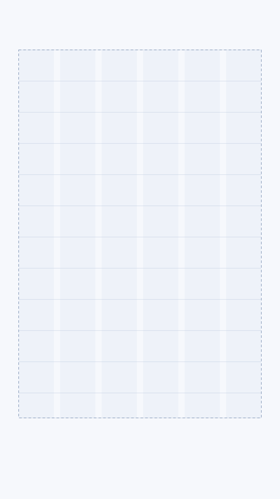
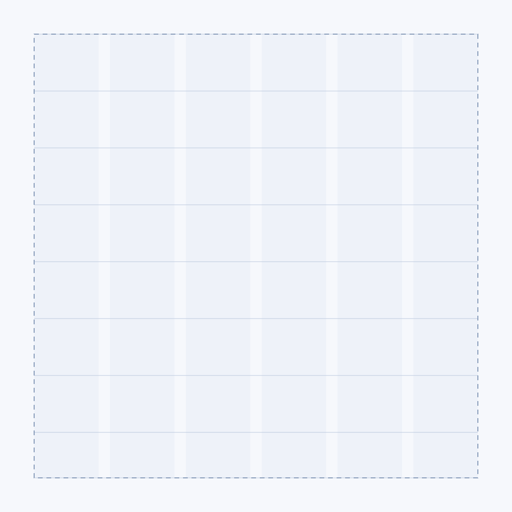
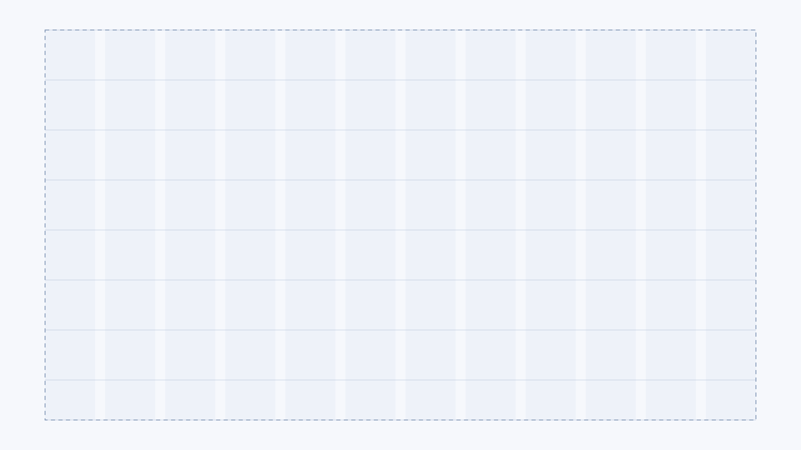

# Hệ grid và tọa độ

## Ba profile và công thức

Grid gốc là hệ tự đề xuất. Đơn vị khoảng cách cơ bản 12 px. Gutter 24 px. Những giá trị này là quyết định thiết kế của bộ tài liệu.

| Profile | Canvas | Vùng nội dung x y w h | Cột | Hàng |
| --- | --- | --- | --- | --- |
| P | 1080 × 1920 | 72, 192, 936, 1416 | 6 × 136 px | 12 × 96 px |
| S | 1080 × 1080 | 72, 72, 936, 936 | 6 × 136 px | 8 × 96 px |
| L | 1920 × 1080 | 108, 72, 1704, 936 | 12 × 120 px | 8 × 96 px |

- Chiều rộng nội dung = số cột × chiều rộng cột + (số cột − 1) × gutter.
- Span n cột = n × chiều rộng cột + (n − 1) × gutter.
- Chiều cao vùng nội dung = số hàng × 96 + (số hàng − 1) × 24.
- Tọa độ cột i = x vùng nội dung + (i − 1) × (chiều rộng cột + 24).
- Tọa độ hàng j = y vùng nội dung + (j − 1) × 120.
- Tọa độ chuẩn hóa canvas: nx=x/W, ny=y/H, nw=w/W, nh=h/H. Không dùng các tỷ lệ này để tự động kéo giãn chữ sang khổ khác.

## Khoảng đệm và vùng đọc

Profile P chừa 72 px trái/phải, 192 px phía trên và 312 px phía dưới. Đây là vùng đệm sản xuất đề xuất, KHÔNG phải safe zone được nền tảng xác nhận. Khi đăng thật phải xem preview trong đúng ứng dụng, tài khoản và vị trí quảng cáo. Phụ đề, nút và giao diện có thể che các vùng khác nhau.

Chữ quan trọng và CTA nằm trong vùng nội dung ở trạng thái đọc. Background và lớp wipe có thể phủ toàn canvas. Motion vào/ra có thể đi qua đường giới hạn; trạng thái đọc phải trở về đúng vùng đã bố trí.

Tâm canvas P là (540,960), còn tâm vùng nội dung là (540,900). Không căn giữa nhầm hai tâm này.

## Hướng dẫn dựng guides

Guides được đặt tại cả cạnh trái và cạnh phải từng cột, cạnh trên và cạnh dưới từng hàng. Các vạch baseline 12 px là lưới nhịp bổ sung; không phải mọi chiều rộng cột đều bắt buộc là bội số của 12.

## Profile P Portrait

| Cột | Trái x | Phải x |
| --- | --- | --- |
| 1 | 72 | 208 |
| 2 | 232 | 368 |
| 3 | 392 | 528 |
| 4 | 552 | 688 |
| 5 | 712 | 848 |
| 6 | 872 | 1008 |

| Hàng | Trên y | Dưới y |
| --- | --- | --- |
| 1 | 192 | 288 |
| 2 | 312 | 408 |
| 3 | 432 | 528 |
| 4 | 552 | 648 |
| 5 | 672 | 768 |
| 6 | 792 | 888 |
| 7 | 912 | 1008 |
| 8 | 1032 | 1128 |
| 9 | 1152 | 1248 |
| 10 | 1272 | 1368 |
| 11 | 1392 | 1488 |
| 12 | 1512 | 1608 |

| Số cột span | Chiều rộng px |
| --- | --- |
| 1 | 136 |
| 2 | 296 |
| 3 | 456 |
| 4 | 616 |
| 5 | 776 |
| 6 | 936 |

## Profile S Square

| Cột | Trái x | Phải x |
| --- | --- | --- |
| 1 | 72 | 208 |
| 2 | 232 | 368 |
| 3 | 392 | 528 |
| 4 | 552 | 688 |
| 5 | 712 | 848 |
| 6 | 872 | 1008 |

| Hàng | Trên y | Dưới y |
| --- | --- | --- |
| 1 | 72 | 168 |
| 2 | 192 | 288 |
| 3 | 312 | 408 |
| 4 | 432 | 528 |
| 5 | 552 | 648 |
| 6 | 672 | 768 |
| 7 | 792 | 888 |
| 8 | 912 | 1008 |

| Số cột span | Chiều rộng px |
| --- | --- |
| 1 | 136 |
| 2 | 296 |
| 3 | 456 |
| 4 | 616 |
| 5 | 776 |
| 6 | 936 |

## Profile L Landscape

| Cột | Trái x | Phải x |
| --- | --- | --- |
| 1 | 108 | 228 |
| 2 | 252 | 372 |
| 3 | 396 | 516 |
| 4 | 540 | 660 |
| 5 | 684 | 804 |
| 6 | 828 | 948 |
| 7 | 972 | 1092 |
| 8 | 1116 | 1236 |
| 9 | 1260 | 1380 |
| 10 | 1404 | 1524 |
| 11 | 1548 | 1668 |
| 12 | 1692 | 1812 |

| Hàng | Trên y | Dưới y |
| --- | --- | --- |
| 1 | 72 | 168 |
| 2 | 192 | 288 |
| 3 | 312 | 408 |
| 4 | 432 | 528 |
| 5 | 552 | 648 |
| 6 | 672 | 768 |
| 7 | 792 | 888 |
| 8 | 912 | 1008 |

| Số cột span | Chiều rộng px |
| --- | --- |
| 1 | 120 |
| 2 | 264 |
| 3 | 408 |
| 4 | 552 |
| 5 | 696 |
| 6 | 840 |
| 7 | 984 |
| 8 | 1128 |
| 9 | 1272 |
| 10 | 1416 |
| 11 | 1560 |
| 12 | 1704 |

## Chuyển tỷ lệ bằng reflow

1. Giữ quan hệ ưu tiên thông tin, không scale nguyên comp dọc thành ngang.
2. P → L: các cụm đang xếp dọc có thể nằm cạnh nhau; dùng 12 cột, tính lại vùng text và điểm nhìn.
3. P → S: giảm nội dung phụ hoặc đưa sang cảnh sau; dùng 8 hàng thay cho 12 hàng.
4. Giữ hình tròn là tròn, stroke nhất quán và cỡ chữ phù hợp canvas. Đổi line break trước khi giảm font.
5. Có bảng tọa độ hoàn chỉnh cho L01, L04, L09, L15 ở cả S và L. Các layout còn lại cần reflow riêng; bộ này không tuyên bố đã dựng lại toàn bộ 20 layout ở mọi khổ.

Ví dụ L04: portrait dùng hai cột rộng 456 px; landscape dùng hai vùng rộng 840 px. Tỷ lệ hai phía vẫn ngang nhau nhưng bố cục và cách ngắt dòng được thiết kế lại.
