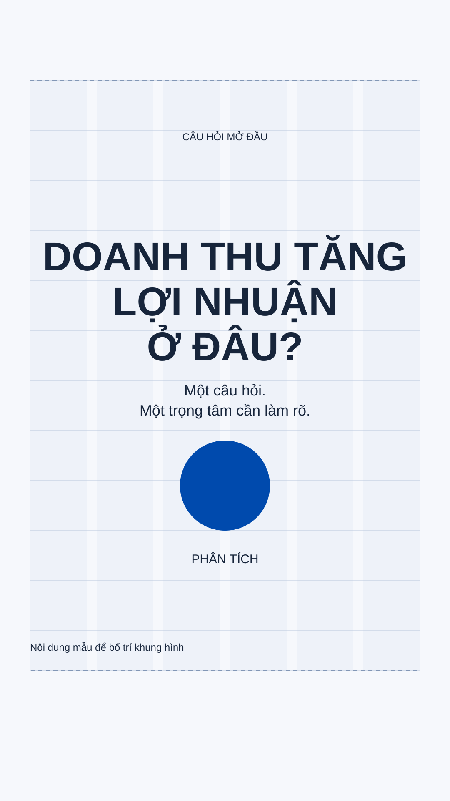
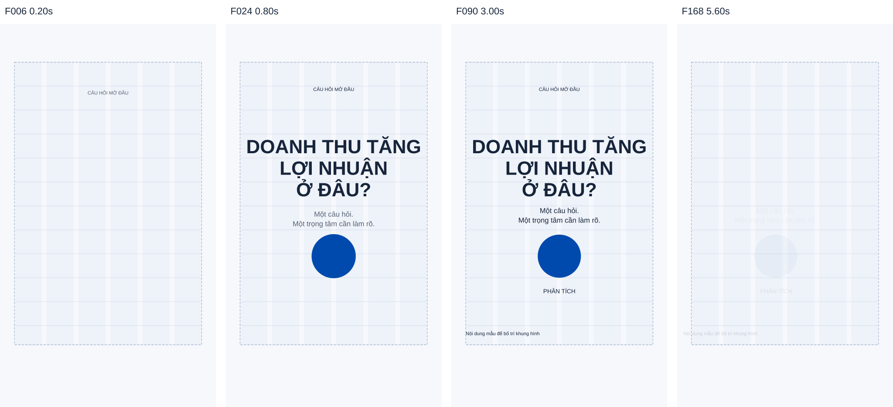
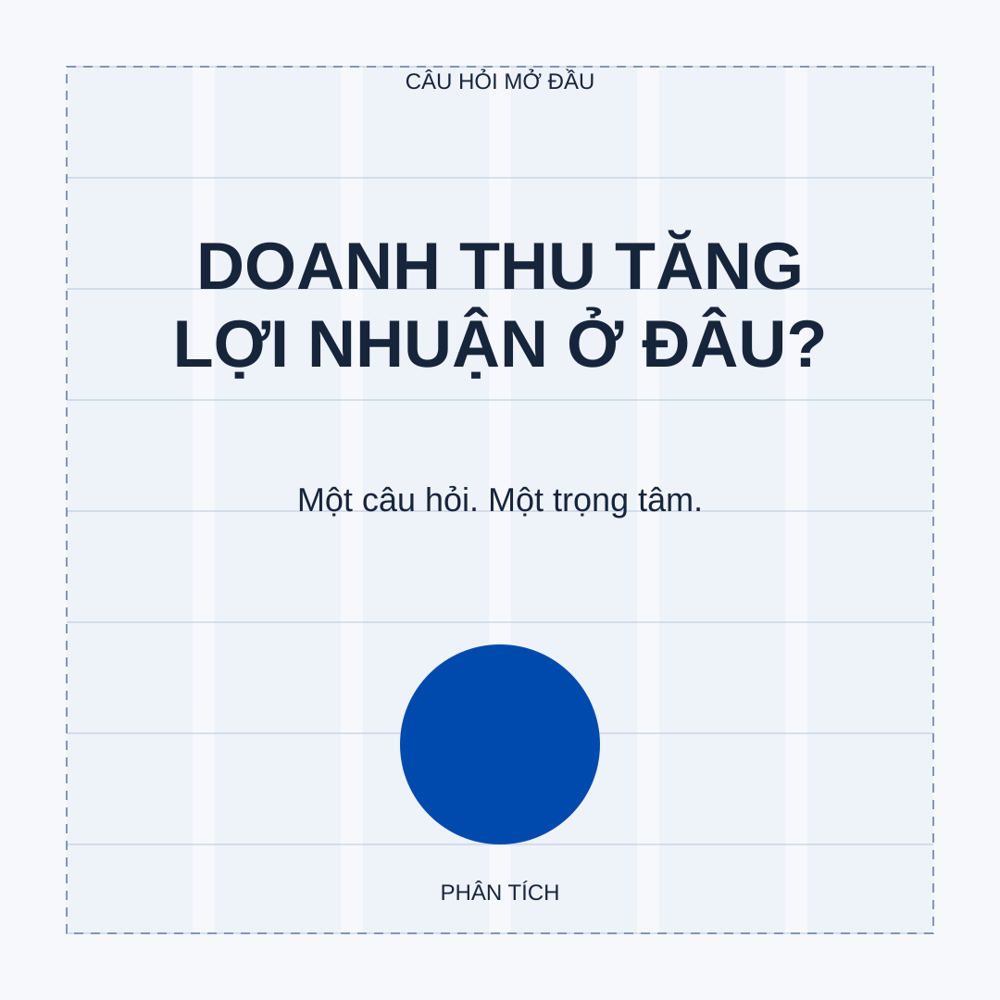
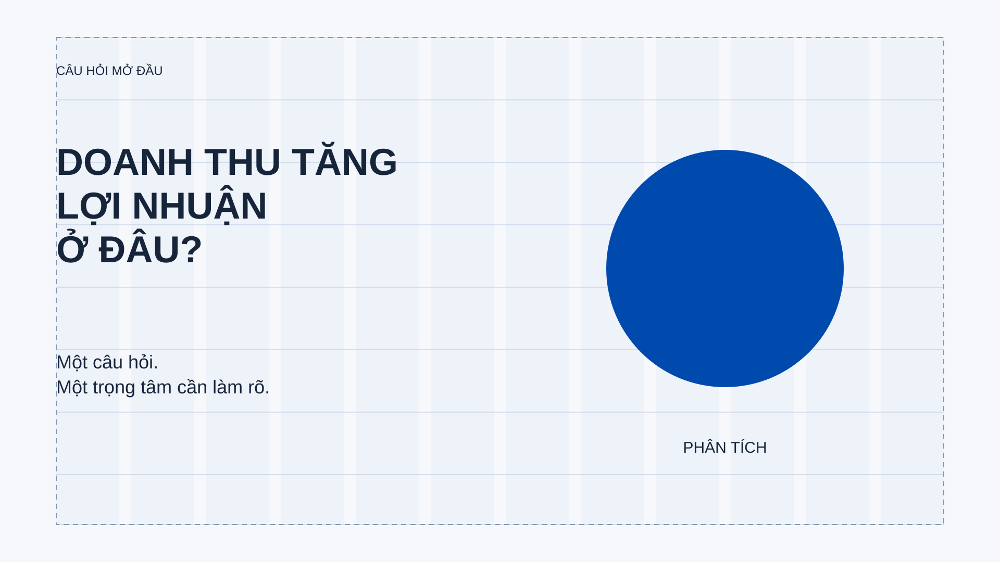

# L01 Hero Hook

Mở video bằng một câu hỏi hoặc một thông điệp duy nhất.

- Profile P 1080 × 1920, 30 fps, 180 frame.
- Phong cách gợi ý: A01 / A02. Bố cục tham chiếu: B01.
- Tọa độ ở trạng thái đọc F090. Z tăng dần từ sau ra trước.

## Layer và vùng bố trí

| Z | Layer | Loại | x | y | w | h | Thông số | Màu token | Nội dung |
| --- | --- | --- | --- | --- | --- | --- | --- | --- | --- |
| 0 | SH_ACCENT | shape | 432 | 1056 | 216 | 216 | circle; radius 24px | brand | — |
| 1 | TXT_EYEBROW | text | 72 | 312 | 936 | 48 | eyebrow: 24/36px, center | ink | CÂU HỎI MỞ ĐẦU |
| 2 | TXT_HEAD | text | 72 | 552 | 936 | 324 | display: 96/108px, center | ink | DOANH THU TĂNG / LỢI NHUẬN / Ở ĐÂU? |
| 3 | TXT_SUPPORT | text | 168 | 912 | 744 | 96 | body: 36/48px, center | ink | Một câu hỏi. / Một trọng tâm cần làm rõ. |
| 4 | TXT_TAG | text | 312 | 1320 | 456 | 60 | small: 30/42px, center | ink | PHÂN TÍCH |
| 5 | TXT_FOOT | text | 72 | 1536 | 936 | 60 | micro: 24/36px, left | ink | Nội dung mẫu để bố trí khung hình |

## Keyframe từng layer

| Layer | Preset | Bắt đầu | Đến đích | Ổn định | Ra hoặc giữ cuối |
| --- | --- | --- | --- | --- | --- |
| SH_ACCENT | M02 | F018: S92%, O0 | F028: S103%, O100 | F036: S100%, O100 | F156→F174: ΔP(0,0)→(-48,0), O100→0 |
| TXT_EYEBROW | M01 | F000: ΔP(0,+60), O0 | F018: ΔP(0,0), O100 | F024: ổn định | F150→F168: ΔP(0,0)→(-48,0), O100→0 |
| TXT_HEAD | M01 | F006: ΔP(0,+60), O0 | F024: ΔP(0,0), O100 | F030: ổn định | F152→F170: ΔP(0,0)→(-48,0), O100→0 |
| TXT_SUPPORT | M01 | F018: ΔP(0,+60), O0 | F036: ΔP(0,0), O100 | F042: ổn định | F156→F174: ΔP(0,0)→(-48,0), O100→0 |
| TXT_TAG | M01 | F024: ΔP(0,+60), O0 | F042: ΔP(0,0), O100 | F048: ổn định | F158→F176: ΔP(0,0)→(-48,0), O100→0 |
| TXT_FOOT | M01 | F030: ΔP(0,+60), O0 | F048: ΔP(0,0), O100 | F054: ổn định | F160→F178: ΔP(0,0)→(-48,0), O100→0 |

## Bốn trạng thái motion

F006 vào, F024 dựng thông tin, F090 đọc, F168 ra hoặc giữ. Các hình minh họa được tính từ preset, không phải AE render.

## Ghi chú nội dung

Tiêu đề tối đa 3 dòng; shape làm dấu nhấn, không mang dữ liệu. Không cho shape đè lên câu hỏi.

## Nối cảnh

E01: khối accent phủ khung bằng một lớp wipe riêng; hoặc cắt khớp hình tròn E02.

## Biến thể S Square

Đây là bố cục đã reflow với tọa độ riêng; motion entry dùng cùng preset và delay của layer.

| Z | Layer | Loại | x | y | w | h | Thông số | Màu token | Nội dung |
| --- | --- | --- | --- | --- | --- | --- | --- | --- | --- |
| 0 | TXT_EYEBROW | text | 72 | 72 | 936 | 48 | eyebrow: 24/36px, center | ink | CÂU HỎI MỞ ĐẦU |
| 1 | TXT_HEAD | text | 72 | 240 | 936 | 216 | title: 72/84px, center | ink | DOANH THU TĂNG / LỢI NHUẬN Ở ĐÂU? |
| 2 | TXT_SUPPORT | text | 72 | 516 | 936 | 96 | body: 36/48px, center | ink | Một câu hỏi. Một trọng tâm. |
| 3 | SH_ACCENT | shape | 432 | 696 | 216 | 216 | circle; radius 24px | brand | — |
| 4 | TXT_TAG | text | 312 | 948 | 456 | 48 | micro: 24/36px, center | ink | PHÂN TÍCH |

## Biến thể L Landscape

Đây là bố cục đã reflow với tọa độ riêng; motion entry dùng cùng preset và delay của layer.

| Z | Layer | Loại | x | y | w | h | Thông số | Màu token | Nội dung |
| --- | --- | --- | --- | --- | --- | --- | --- | --- | --- |
| 0 | TXT_EYEBROW | text | 108 | 120 | 840 | 48 | eyebrow: 24/36px, left | ink | CÂU HỎI MỞ ĐẦU |
| 1 | TXT_HEAD | text | 108 | 264 | 840 | 324 | title: 72/84px, left | ink | DOANH THU TĂNG / LỢI NHUẬN / Ở ĐÂU? |
| 2 | TXT_SUPPORT | text | 108 | 672 | 840 | 144 | body: 36/48px, left | ink | Một câu hỏi. / Một trọng tâm cần làm rõ. |
| 3 | SH_ACCENT | shape | 1164 | 288 | 456 | 456 | circle; radius 24px | brand | — |
| 4 | TXT_TAG | text | 972 | 840 | 840 | 60 | small: 30/42px, center | ink | PHÂN TÍCH |

## Khi thay nội dung

Đo lại độ rộng từng dòng với font thật. Giữ hierarchy, khoảng trống và vùng đọc. Nếu nội dung vượt ô, ưu tiên viết gọn, đổi line break hoặc tăng thời gian và tách cảnh. Không thu toàn bộ chữ đến mức khó đọc.
