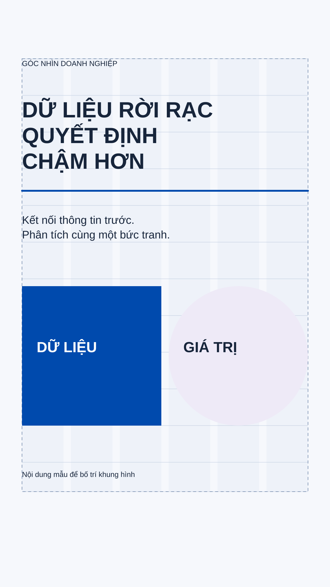
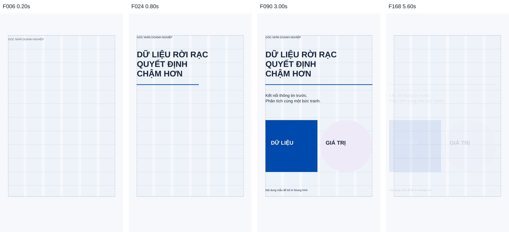

# L02 Editorial Headline

Đưa một nhận định ngắn rồi mở phần giải thích bên dưới.

- Profile P 1080 × 1920, 30 fps, 180 frame.
- Phong cách gợi ý: A02 / A04. Bố cục tham chiếu: B04.
- Tọa độ ở trạng thái đọc F090. Z tăng dần từ sau ra trước.

## Layer và vùng bố trí

| Z | Layer | Loại | x | y | w | h | Thông số | Màu token | Nội dung |
| --- | --- | --- | --- | --- | --- | --- | --- | --- | --- |
| 0 | TXT_EYEBROW | text | 72 | 192 | 936 | 48 | eyebrow: 24/36px, left | ink | GÓC NHÌN DOANH NGHIỆP |
| 1 | TXT_HEAD | text | 72 | 312 | 936 | 264 | title: 72/84px, left | ink | DỮ LIỆU RỜI RẠC / QUYẾT ĐỊNH / CHẬM HƠN |
| 2 | SH_RULE | line | 72 | 624 | 936 | 0 | Stroke 6px; [(72, 624), (1008, 624)] | brand | — |
| 3 | TXT_BODY | text | 72 | 696 | 776 | 144 | body: 36/48px, left | ink | Kết nối thông tin trước. / Phân tích cùng một bức tranh. |
| 4 | SH_BLOCK_A | shape | 72 | 936 | 456 | 456 | rect; radius 0px | brand | — |
| 5 | SH_BLOCK_B | shape | 552 | 936 | 456 | 456 | circle; radius 24px | purple_tint | — |
| 6 | TXT_A | text | 120 | 1104 | 360 | 72 | card_title: 48/60px, left | white | DỮ LIỆU |
| 7 | TXT_B | text | 600 | 1104 | 360 | 72 | card_title: 48/60px, left | ink | GIÁ TRỊ |
| 8 | TXT_FOOT | text | 72 | 1536 | 936 | 60 | micro: 24/36px, left | ink | Nội dung mẫu để bố trí khung hình |

## Keyframe từng layer

| Layer | Preset | Bắt đầu | Đến đích | Ổn định | Ra hoặc giữ cuối |
| --- | --- | --- | --- | --- | --- |
| TXT_EYEBROW | M01 | F000: ΔP(0,+60), O0 | F018: ΔP(0,0), O100 | F024: ổn định | F150→F168: ΔP(0,0)→(-48,0), O100→0 |
| TXT_HEAD | M01 | F006: ΔP(0,+60), O0 | F024: ΔP(0,0), O100 | F030: ổn định | F152→F170: ΔP(0,0)→(-48,0), O100→0 |
| SH_RULE | M03 | F018: End0%, O100 | F042: End100%, O100 | F042: giữ nét | F156→F174: ΔP(0,0)→(-48,0), O100→0 |
| TXT_BODY | M01 | F024: ΔP(0,+60), O0 | F042: ΔP(0,0), O100 | F048: ổn định | F158→F176: ΔP(0,0)→(-48,0), O100→0 |
| SH_BLOCK_A | M02 | F024: S92%, O0 | F034: S103%, O100 | F042: S100%, O100 | F158→F176: ΔP(0,0)→(-48,0), O100→0 |
| SH_BLOCK_B | M02 | F030: S92%, O0 | F040: S103%, O100 | F048: S100%, O100 | F160→F178: ΔP(0,0)→(-48,0), O100→0 |
| TXT_A | M01 | F036: ΔP(0,+60), O0 | F054: ΔP(0,0), O100 | F060: ổn định | F160→F178: ΔP(0,0)→(-48,0), O100→0 |
| TXT_B | M01 | F042: ΔP(0,+60), O0 | F060: ΔP(0,0), O100 | F066: ổn định | F160→F178: ΔP(0,0)→(-48,0), O100→0 |
| TXT_FOOT | M01 | F030: ΔP(0,+60), O0 | F048: ΔP(0,0), O100 | F054: ổn định | F160→F178: ΔP(0,0)→(-48,0), O100→0 |

## Bốn trạng thái motion

F006 vào, F024 dựng thông tin, F090 đọc, F168 ra hoặc giữ. Các hình minh họa được tính từ preset, không phải AE render.

## Ghi chú nội dung

Giữ chữ căn trái. Hai khối là minh họa ý tưởng, dùng cùng kiểu nét và màu xuyên suốt.

## Nối cảnh

E06: các dòng đi ra theo trục X; cảnh sau được đẩy vào cùng hướng.

## Khi thay nội dung

Đo lại độ rộng từng dòng với font thật. Giữ hierarchy, khoảng trống và vùng đọc. Nếu nội dung vượt ô, ưu tiên viết gọn, đổi line break hoặc tăng thời gian và tách cảnh. Không thu toàn bộ chữ đến mức khó đọc.
