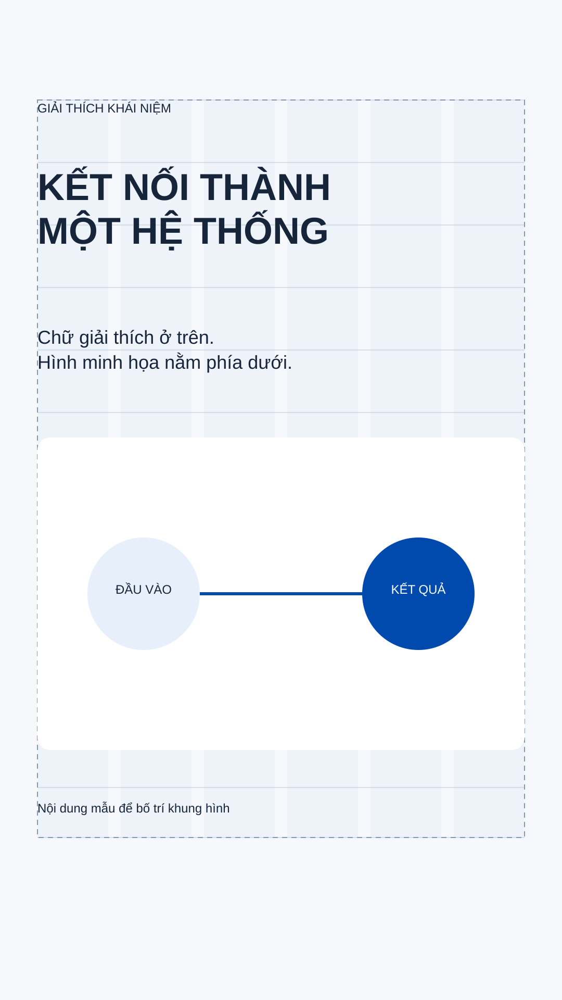
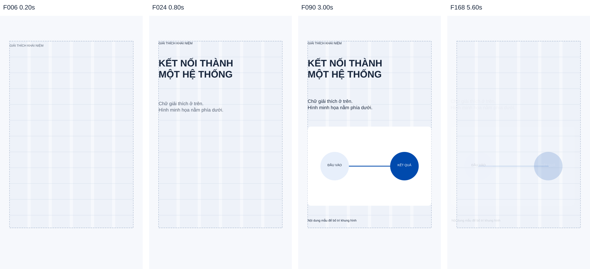

# L03 Text And Visual Stack

Một khái niệm được giải thích bằng chữ và minh họa có vùng riêng.

- Profile P 1080 × 1920, 30 fps, 180 frame.
- Phong cách gợi ý: A05 / A06. Bố cục tham chiếu: B02.
- Tọa độ ở trạng thái đọc F090. Z tăng dần từ sau ra trước.

## Layer và vùng bố trí

| Z | Layer | Loại | x | y | w | h | Thông số | Màu token | Nội dung |
| --- | --- | --- | --- | --- | --- | --- | --- | --- | --- |
| 0 | TXT_EYEBROW | text | 72 | 192 | 936 | 48 | eyebrow: 24/36px, left | ink | GIẢI THÍCH KHÁI NIỆM |
| 1 | TXT_HEAD | text | 72 | 312 | 936 | 264 | title: 72/84px, left | ink | KẾT NỐI THÀNH / MỘT HỆ THỐNG |
| 2 | TXT_BODY | text | 72 | 624 | 936 | 96 | body: 36/48px, left | ink | Chữ giải thích ở trên. / Hình minh họa nằm phía dưới. |
| 3 | SH_VISUAL | shape | 72 | 840 | 936 | 600 | rect; radius 24px | white | — |
| 4 | SH_LINK | line | 276 | 1140 | 528 | 0 | Stroke 6px; [(276, 1140), (804, 1140)] | brand | — |
| 5 | SH_NODE_A | shape | 168 | 1032 | 216 | 216 | circle; radius 24px | tint | — |
| 6 | SH_NODE_B | shape | 696 | 1032 | 216 | 216 | circle; radius 24px | brand | — |
| 7 | TXT_NODE_A | text | 180 | 1116 | 192 | 48 | micro: 24/36px, center | ink | ĐẦU VÀO |
| 8 | TXT_NODE_B | text | 708 | 1116 | 192 | 48 | micro: 24/36px, center | white | KẾT QUẢ |
| 9 | TXT_FOOT | text | 72 | 1536 | 936 | 60 | micro: 24/36px, left | ink | Nội dung mẫu để bố trí khung hình |

## Keyframe từng layer

| Layer | Preset | Bắt đầu | Đến đích | Ổn định | Ra hoặc giữ cuối |
| --- | --- | --- | --- | --- | --- |
| TXT_EYEBROW | M01 | F000: ΔP(0,+60), O0 | F018: ΔP(0,0), O100 | F024: ổn định | F150→F168: ΔP(0,0)→(-48,0), O100→0 |
| TXT_HEAD | M01 | F006: ΔP(0,+60), O0 | F024: ΔP(0,0), O100 | F030: ổn định | F152→F170: ΔP(0,0)→(-48,0), O100→0 |
| TXT_BODY | M01 | F018: ΔP(0,+60), O0 | F036: ΔP(0,0), O100 | F042: ổn định | F156→F174: ΔP(0,0)→(-48,0), O100→0 |
| SH_VISUAL | M02 | F024: S92%, O0 | F034: S103%, O100 | F042: S100%, O100 | F158→F176: ΔP(0,0)→(-48,0), O100→0 |
| SH_LINK | M03 | F036: End0%, O100 | F060: End100%, O100 | F060: giữ nét | F160→F178: ΔP(0,0)→(-48,0), O100→0 |
| SH_NODE_A | M02 | F030: S92%, O0 | F040: S103%, O100 | F048: S100%, O100 | F160→F178: ΔP(0,0)→(-48,0), O100→0 |
| SH_NODE_B | M02 | F036: S92%, O0 | F046: S103%, O100 | F054: S100%, O100 | F160→F178: ΔP(0,0)→(-48,0), O100→0 |
| TXT_NODE_A | M01 | F042: ΔP(0,+60), O0 | F060: ΔP(0,0), O100 | F066: ổn định | F160→F178: ΔP(0,0)→(-48,0), O100→0 |
| TXT_NODE_B | M01 | F048: ΔP(0,+60), O0 | F066: ΔP(0,0), O100 | F072: ổn định | F160→F178: ΔP(0,0)→(-48,0), O100→0 |
| TXT_FOOT | M01 | F030: ΔP(0,+60), O0 | F048: ΔP(0,0), O100 | F054: ổn định | F160→F178: ΔP(0,0)→(-48,0), O100→0 |

## Bốn trạng thái motion

F006 vào, F024 dựng thông tin, F090 đọc, F168 ra hoặc giữ. Các hình minh họa được tính từ preset, không phải AE render.

## Ghi chú nội dung

Không dùng quá 2 dòng body. Khi cần thêm ý, tách sang cảnh sau thay vì thu chữ.

## Nối cảnh

E04: đi vào node kết quả để chuyển sang cảnh chi tiết.

## Khi thay nội dung

Đo lại độ rộng từng dòng với font thật. Giữ hierarchy, khoảng trống và vùng đọc. Nếu nội dung vượt ô, ưu tiên viết gọn, đổi line break hoặc tăng thời gian và tách cảnh. Không thu toàn bộ chữ đến mức khó đọc.
