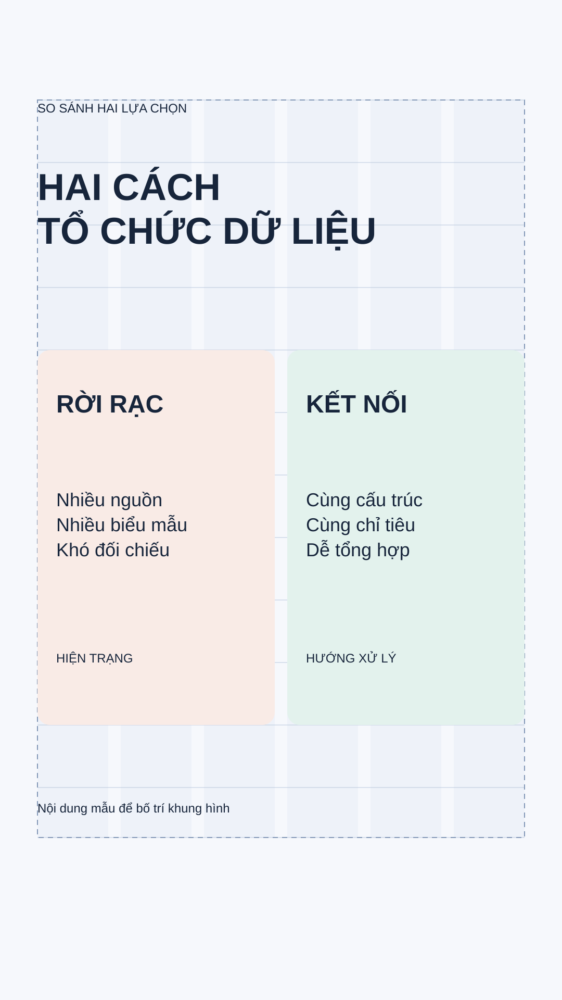
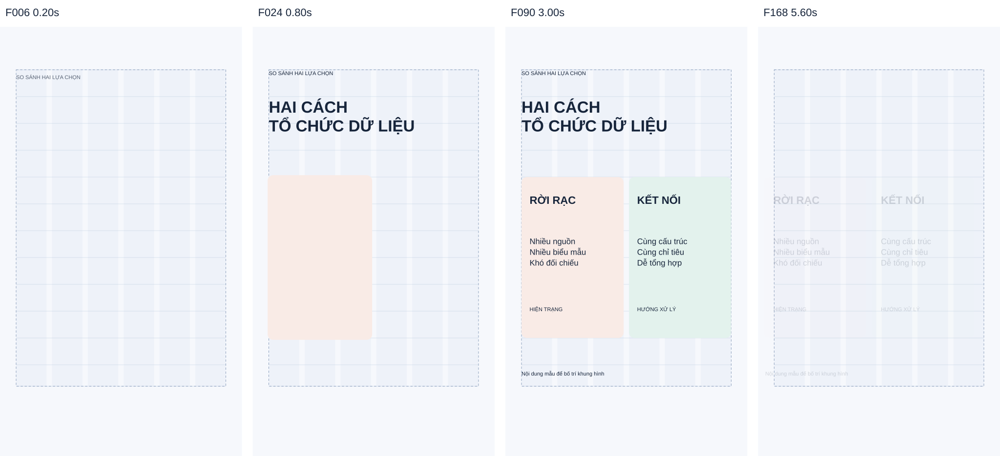
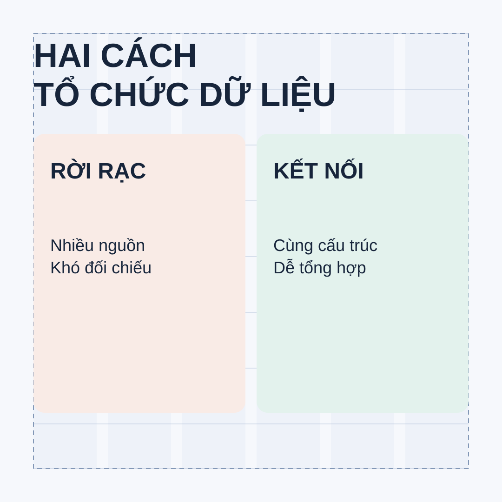
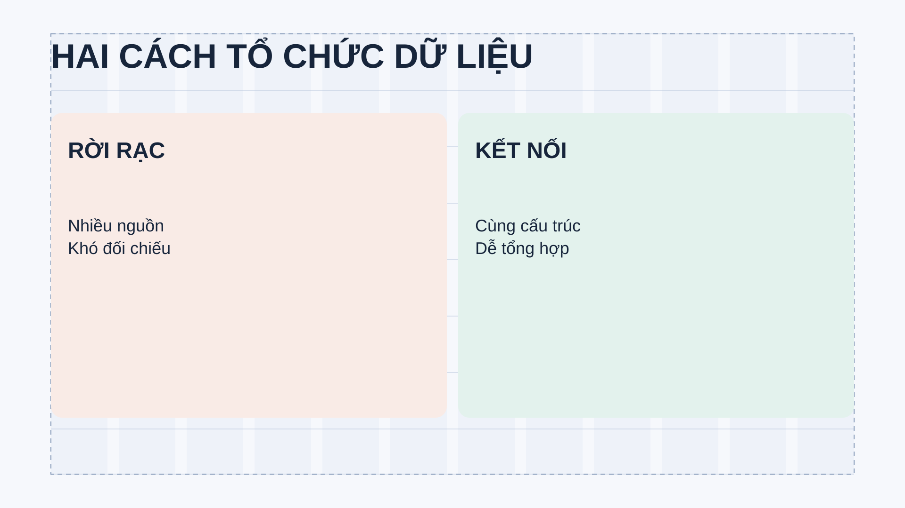

# L04 Two Column Comparison

So sánh hai phương án bằng các thuộc tính cùng cấp.

- Profile P 1080 × 1920, 30 fps, 180 frame.
- Phong cách gợi ý: A01 / A02. Bố cục tham chiếu: B02.
- Tọa độ ở trạng thái đọc F090. Z tăng dần từ sau ra trước.

## Layer và vùng bố trí

| Z | Layer | Loại | x | y | w | h | Thông số | Màu token | Nội dung |
| --- | --- | --- | --- | --- | --- | --- | --- | --- | --- |
| 0 | TXT_EYEBROW | text | 72 | 192 | 936 | 48 | eyebrow: 24/36px, left | ink | SO SÁNH HAI LỰA CHỌN |
| 1 | TXT_HEAD | text | 72 | 312 | 936 | 264 | title: 72/84px, left | ink | HAI CÁCH / TỔ CHỨC DỮ LIỆU |
| 2 | SH_LEFT | shape | 72 | 672 | 456 | 720 | rect; radius 24px | warm_tint | — |
| 3 | SH_RIGHT | shape | 552 | 672 | 456 | 720 | rect; radius 24px | green_tint | — |
| 4 | TXT_LEFT_HEAD | text | 108 | 744 | 384 | 72 | card_title: 48/60px, left | ink | RỜI RẠC |
| 5 | TXT_RIGHT_HEAD | text | 588 | 744 | 384 | 72 | card_title: 48/60px, left | ink | KẾT NỐI |
| 6 | TXT_LEFT_BODY | text | 108 | 936 | 384 | 192 | body: 36/48px, left | ink | Nhiều nguồn / Nhiều biểu mẫu / Khó đối chiếu |
| 7 | TXT_RIGHT_BODY | text | 588 | 936 | 384 | 192 | body: 36/48px, left | ink | Cùng cấu trúc / Cùng chỉ tiêu / Dễ tổng hợp |
| 8 | TXT_LEFT_TAG | text | 108 | 1248 | 384 | 48 | micro: 24/36px, left | ink | HIỆN TRẠNG |
| 9 | TXT_RIGHT_TAG | text | 588 | 1248 | 384 | 48 | micro: 24/36px, left | ink | HƯỚNG XỬ LÝ |
| 10 | TXT_FOOT | text | 72 | 1536 | 936 | 60 | micro: 24/36px, left | ink | Nội dung mẫu để bố trí khung hình |

## Keyframe từng layer

| Layer | Preset | Bắt đầu | Đến đích | Ổn định | Ra hoặc giữ cuối |
| --- | --- | --- | --- | --- | --- |
| TXT_EYEBROW | M01 | F000: ΔP(0,+60), O0 | F018: ΔP(0,0), O100 | F024: ổn định | F150→F168: ΔP(0,0)→(-48,0), O100→0 |
| TXT_HEAD | M01 | F006: ΔP(0,+60), O0 | F024: ΔP(0,0), O100 | F030: ổn định | F152→F170: ΔP(0,0)→(-48,0), O100→0 |
| SH_LEFT | M02 | F018: S92%, O0 | F028: S103%, O100 | F036: S100%, O100 | F156→F174: ΔP(0,0)→(-48,0), O100→0 |
| SH_RIGHT | M02 | F024: S92%, O0 | F034: S103%, O100 | F042: S100%, O100 | F158→F176: ΔP(0,0)→(-48,0), O100→0 |
| TXT_LEFT_HEAD | M01 | F030: ΔP(0,+60), O0 | F048: ΔP(0,0), O100 | F054: ổn định | F160→F178: ΔP(0,0)→(-48,0), O100→0 |
| TXT_RIGHT_HEAD | M01 | F036: ΔP(0,+60), O0 | F054: ΔP(0,0), O100 | F060: ổn định | F160→F178: ΔP(0,0)→(-48,0), O100→0 |
| TXT_LEFT_BODY | M01 | F042: ΔP(0,+60), O0 | F060: ΔP(0,0), O100 | F066: ổn định | F160→F178: ΔP(0,0)→(-48,0), O100→0 |
| TXT_RIGHT_BODY | M01 | F048: ΔP(0,+60), O0 | F066: ΔP(0,0), O100 | F072: ổn định | F160→F178: ΔP(0,0)→(-48,0), O100→0 |
| TXT_LEFT_TAG | M01 | F048: ΔP(0,+60), O0 | F066: ΔP(0,0), O100 | F072: ổn định | F160→F178: ΔP(0,0)→(-48,0), O100→0 |
| TXT_RIGHT_TAG | M01 | F048: ΔP(0,+60), O0 | F066: ΔP(0,0), O100 | F072: ổn định | F160→F178: ΔP(0,0)→(-48,0), O100→0 |
| TXT_FOOT | M01 | F030: ΔP(0,+60), O0 | F048: ΔP(0,0), O100 | F054: ổn định | F160→F178: ΔP(0,0)→(-48,0), O100→0 |

## Bốn trạng thái motion

F006 vào, F024 dựng thông tin, F090 đọc, F168 ra hoặc giữ. Các hình minh họa được tính từ preset, không phải AE render.

## Ghi chú nội dung

Hai cột phải dùng cùng số dòng và cùng cách căn lề. Màu chỉ hỗ trợ ý nghĩa đã ghi bằng chữ.

## Nối cảnh

E07: tách hai panel rồi mở cảnh mới; không biến một so sánh thành kết luận thiếu nguồn.

## Biến thể S Square

Đây là bố cục đã reflow với tọa độ riêng; motion entry dùng cùng preset và delay của layer.

| Z | Layer | Loại | x | y | w | h | Thông số | Màu token | Nội dung |
| --- | --- | --- | --- | --- | --- | --- | --- | --- | --- |
| 0 | TXT_HEAD | text | 72 | 72 | 936 | 168 | title: 72/84px, left | ink | HAI CÁCH / TỔ CHỨC DỮ LIỆU |
| 1 | SH_CARD_1 | shape | 72 | 288 | 456 | 600 | rect; radius 24px | warm_tint | — |
| 2 | TXT_CARD_HEAD_1 | text | 108 | 336 | 384 | 72 | card_title: 48/60px, left | ink | RỜI RẠC |
| 3 | TXT_CARD_BODY_1 | text | 108 | 504 | 384 | 192 | body: 36/48px, left | ink | Nhiều nguồn / Khó đối chiếu |
| 4 | SH_CARD_2 | shape | 552 | 288 | 456 | 600 | rect; radius 24px | green_tint | — |
| 5 | TXT_CARD_HEAD_2 | text | 588 | 336 | 384 | 72 | card_title: 48/60px, left | ink | KẾT NỐI |
| 6 | TXT_CARD_BODY_2 | text | 588 | 504 | 384 | 192 | body: 36/48px, left | ink | Cùng cấu trúc / Dễ tổng hợp |

## Biến thể L Landscape

Đây là bố cục đã reflow với tọa độ riêng; motion entry dùng cùng preset và delay của layer.

| Z | Layer | Loại | x | y | w | h | Thông số | Màu token | Nội dung |
| --- | --- | --- | --- | --- | --- | --- | --- | --- | --- |
| 0 | TXT_HEAD | text | 108 | 72 | 1704 | 96 | title: 72/84px, left | ink | HAI CÁCH TỔ CHỨC DỮ LIỆU |
| 1 | SH_CARD_1 | shape | 108 | 240 | 840 | 648 | rect; radius 24px | warm_tint | — |
| 2 | TXT_CARD_HEAD_1 | text | 144 | 288 | 768 | 72 | card_title: 48/60px, left | ink | RỜI RẠC |
| 3 | TXT_CARD_BODY_1 | text | 144 | 456 | 768 | 192 | body: 36/48px, left | ink | Nhiều nguồn / Khó đối chiếu |
| 4 | SH_CARD_2 | shape | 972 | 240 | 840 | 648 | rect; radius 24px | green_tint | — |
| 5 | TXT_CARD_HEAD_2 | text | 1008 | 288 | 768 | 72 | card_title: 48/60px, left | ink | KẾT NỐI |
| 6 | TXT_CARD_BODY_2 | text | 1008 | 456 | 768 | 192 | body: 36/48px, left | ink | Cùng cấu trúc / Dễ tổng hợp |

## Khi thay nội dung

Đo lại độ rộng từng dòng với font thật. Giữ hierarchy, khoảng trống và vùng đọc. Nếu nội dung vượt ô, ưu tiên viết gọn, đổi line break hoặc tăng thời gian và tách cảnh. Không thu toàn bộ chữ đến mức khó đọc.
