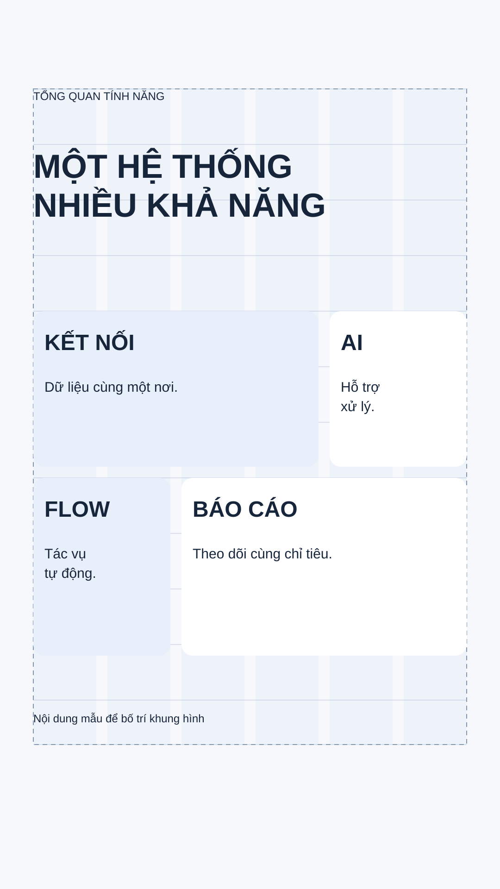
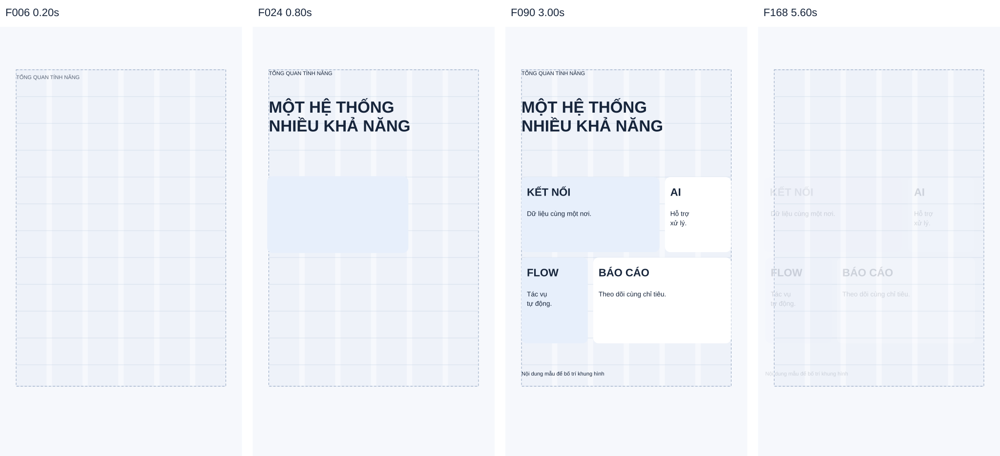

# L06 Asymmetric Bento

Tổng quan nhiều nội dung với một số ô được ưu tiên hơn.

- Profile P 1080 × 1920, 30 fps, 180 frame.
- Phong cách gợi ý: A01 / A15. Bố cục tham chiếu: B03.
- Tọa độ ở trạng thái đọc F090. Z tăng dần từ sau ra trước.

## Layer và vùng bố trí

| Z | Layer | Loại | x | y | w | h | Thông số | Màu token | Nội dung |
| --- | --- | --- | --- | --- | --- | --- | --- | --- | --- |
| 0 | TXT_EYEBROW | text | 72 | 192 | 936 | 48 | eyebrow: 24/36px, left | ink | TỔNG QUAN TÍNH NĂNG |
| 1 | TXT_HEAD | text | 72 | 312 | 936 | 264 | title: 72/84px, left | ink | MỘT HỆ THỐNG / NHIỀU KHẢ NĂNG |
| 2 | SH_TILE_1 | shape | 72 | 672 | 616 | 336 | rect; radius 24px | tint | — |
| 3 | TXT_TILE_HEAD_1 | text | 96 | 708 | 568 | 72 | card_title: 48/60px, left | ink | KẾT NỐI |
| 4 | TXT_TILE_BODY_1 | text | 96 | 816 | 568 | 144 | small: 30/42px, left | ink | Dữ liệu cùng một nơi. |
| 5 | SH_TILE_2 | shape | 712 | 672 | 296 | 336 | rect; radius 24px | white | — |
| 6 | TXT_TILE_HEAD_2 | text | 736 | 708 | 248 | 72 | card_title: 48/60px, left | ink | AI |
| 7 | TXT_TILE_BODY_2 | text | 736 | 816 | 248 | 144 | small: 30/42px, left | ink | Hỗ trợ / xử lý. |
| 8 | SH_TILE_3 | shape | 72 | 1032 | 296 | 384 | rect; radius 24px | tint | — |
| 9 | TXT_TILE_HEAD_3 | text | 96 | 1068 | 248 | 72 | card_title: 48/60px, left | ink | FLOW |
| 10 | TXT_TILE_BODY_3 | text | 96 | 1176 | 248 | 144 | small: 30/42px, left | ink | Tác vụ / tự động. |
| 11 | SH_TILE_4 | shape | 392 | 1032 | 616 | 384 | rect; radius 24px | white | — |
| 12 | TXT_TILE_HEAD_4 | text | 416 | 1068 | 568 | 72 | card_title: 48/60px, left | ink | BÁO CÁO |
| 13 | TXT_TILE_BODY_4 | text | 416 | 1176 | 568 | 144 | small: 30/42px, left | ink | Theo dõi cùng chỉ tiêu. |
| 14 | TXT_FOOT | text | 72 | 1536 | 936 | 60 | micro: 24/36px, left | ink | Nội dung mẫu để bố trí khung hình |

## Keyframe từng layer

| Layer | Preset | Bắt đầu | Đến đích | Ổn định | Ra hoặc giữ cuối |
| --- | --- | --- | --- | --- | --- |
| TXT_EYEBROW | M01 | F000: ΔP(0,+60), O0 | F018: ΔP(0,0), O100 | F024: ổn định | F150→F168: ΔP(0,0)→(-48,0), O100→0 |
| TXT_HEAD | M01 | F006: ΔP(0,+60), O0 | F024: ΔP(0,0), O100 | F030: ổn định | F152→F170: ΔP(0,0)→(-48,0), O100→0 |
| SH_TILE_1 | M02 | F018: S92%, O0 | F028: S103%, O100 | F036: S100%, O100 | F156→F174: ΔP(0,0)→(-48,0), O100→0 |
| TXT_TILE_HEAD_1 | M01 | F024: ΔP(0,+60), O0 | F042: ΔP(0,0), O100 | F048: ổn định | F158→F176: ΔP(0,0)→(-48,0), O100→0 |
| TXT_TILE_BODY_1 | M01 | F030: ΔP(0,+60), O0 | F048: ΔP(0,0), O100 | F054: ổn định | F160→F178: ΔP(0,0)→(-48,0), O100→0 |
| SH_TILE_2 | M02 | F024: S92%, O0 | F034: S103%, O100 | F042: S100%, O100 | F158→F176: ΔP(0,0)→(-48,0), O100→0 |
| TXT_TILE_HEAD_2 | M01 | F030: ΔP(0,+60), O0 | F048: ΔP(0,0), O100 | F054: ổn định | F160→F178: ΔP(0,0)→(-48,0), O100→0 |
| TXT_TILE_BODY_2 | M01 | F036: ΔP(0,+60), O0 | F054: ΔP(0,0), O100 | F060: ổn định | F160→F178: ΔP(0,0)→(-48,0), O100→0 |
| SH_TILE_3 | M02 | F030: S92%, O0 | F040: S103%, O100 | F048: S100%, O100 | F160→F178: ΔP(0,0)→(-48,0), O100→0 |
| TXT_TILE_HEAD_3 | M01 | F036: ΔP(0,+60), O0 | F054: ΔP(0,0), O100 | F060: ổn định | F160→F178: ΔP(0,0)→(-48,0), O100→0 |
| TXT_TILE_BODY_3 | M01 | F042: ΔP(0,+60), O0 | F060: ΔP(0,0), O100 | F066: ổn định | F160→F178: ΔP(0,0)→(-48,0), O100→0 |
| SH_TILE_4 | M02 | F036: S92%, O0 | F046: S103%, O100 | F054: S100%, O100 | F160→F178: ΔP(0,0)→(-48,0), O100→0 |
| TXT_TILE_HEAD_4 | M01 | F042: ΔP(0,+60), O0 | F060: ΔP(0,0), O100 | F066: ổn định | F160→F178: ΔP(0,0)→(-48,0), O100→0 |
| TXT_TILE_BODY_4 | M01 | F048: ΔP(0,+60), O0 | F066: ΔP(0,0), O100 | F072: ổn định | F160→F178: ΔP(0,0)→(-48,0), O100→0 |
| TXT_FOOT | M01 | F030: ΔP(0,+60), O0 | F048: ΔP(0,0), O100 | F054: ổn định | F160→F178: ΔP(0,0)→(-48,0), O100→0 |

## Bốn trạng thái motion

F006 vào, F024 dựng thông tin, F090 đọc, F168 ra hoặc giữ. Các hình minh họa được tính từ preset, không phải AE render.

## Ghi chú nội dung

Kích thước ô gợi mức ưu tiên nội dung, không đại diện định lượng. Khi chữ dài phải đổi ô hoặc đổi bố cục.

## Nối cảnh

D12 rồi E04: ô được chọn mở rộng; các ô còn lại đi ra.

## Khi thay nội dung

Đo lại độ rộng từng dòng với font thật. Giữ hierarchy, khoảng trống và vùng đọc. Nếu nội dung vượt ô, ưu tiên viết gọn, đổi line break hoặc tăng thời gian và tách cảnh. Không thu toàn bộ chữ đến mức khó đọc.
