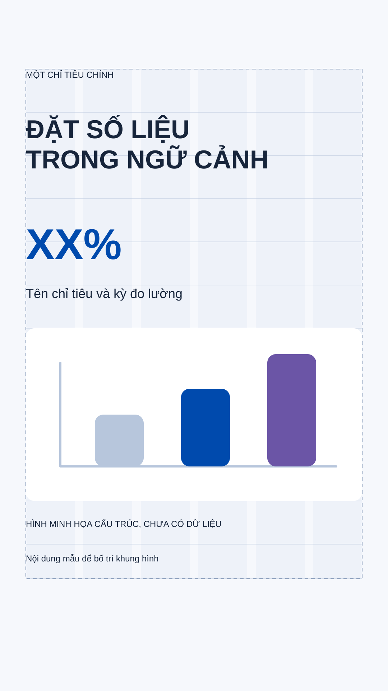
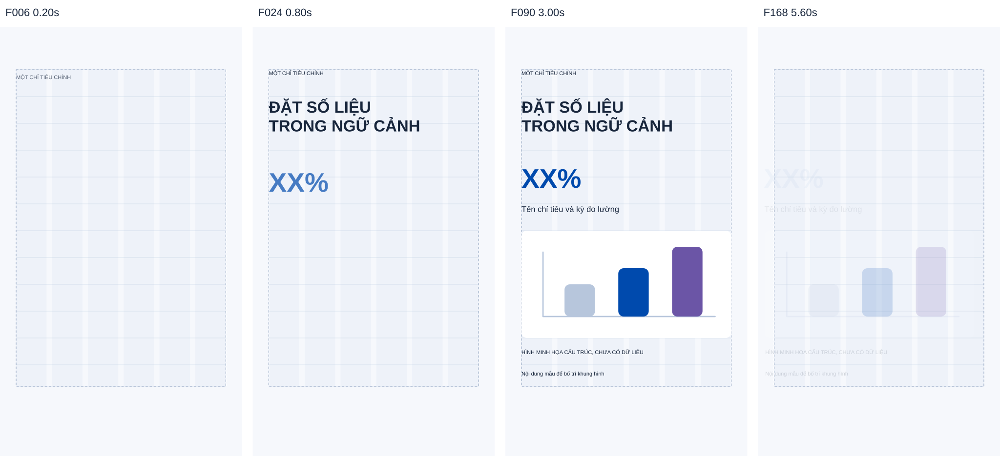

# L07 KPI Hero And Chart

Trình bày một chỉ tiêu chính và phần hình giải thích đi kèm.

- Profile P 1080 × 1920, 30 fps, 180 frame.
- Phong cách gợi ý: A01 / A07. Bố cục tham chiếu: B05.
- Tọa độ ở trạng thái đọc F090. Z tăng dần từ sau ra trước.

## Layer và vùng bố trí

| Z | Layer | Loại | x | y | w | h | Thông số | Màu token | Nội dung |
| --- | --- | --- | --- | --- | --- | --- | --- | --- | --- |
| 0 | TXT_EYEBROW | text | 72 | 192 | 936 | 48 | eyebrow: 24/36px, left | ink | MỘT CHỈ TIÊU CHÍNH |
| 1 | TXT_HEAD | text | 72 | 312 | 936 | 264 | title: 72/84px, left | ink | ĐẶT SỐ LIỆU / TRONG NGỮ CẢNH |
| 2 | TXT_KPI | text | 72 | 600 | 936 | 156 | number: 120/132px, left | brand | XX% |
| 3 | TXT_KPI_LABEL | text | 72 | 792 | 936 | 60 | body: 36/48px, left | ink | Tên chỉ tiêu và kỳ đo lường |
| 4 | SH_CHART_PANEL | shape | 72 | 912 | 936 | 480 | rect; radius 24px | white | — |
| 5 | SH_AXIS | line | 168 | 1008 | 768 | 288 | Stroke 6px; [(168, 1008), (168, 1296), (936, 1296)] | line | — |
| 6 | SH_BAR_1 | shape | 264 | 1152 | 136 | 144 | rect; radius 24px | line | — |
| 7 | SH_BAR_2 | shape | 504 | 1080 | 136 | 216 | rect; radius 24px | brand | — |
| 8 | SH_BAR_3 | shape | 744 | 984 | 136 | 312 | rect; radius 24px | purple | — |
| 9 | TXT_NOTE | text | 72 | 1440 | 936 | 60 | micro: 24/36px, left | ink | HÌNH MINH HỌA CẤU TRÚC, CHƯA CÓ DỮ LIỆU |
| 10 | TXT_FOOT | text | 72 | 1536 | 936 | 60 | micro: 24/36px, left | ink | Nội dung mẫu để bố trí khung hình |

## Keyframe từng layer

| Layer | Preset | Bắt đầu | Đến đích | Ổn định | Ra hoặc giữ cuối |
| --- | --- | --- | --- | --- | --- |
| TXT_EYEBROW | M01 | F000: ΔP(0,+60), O0 | F018: ΔP(0,0), O100 | F024: ổn định | F150→F168: ΔP(0,0)→(-48,0), O100→0 |
| TXT_HEAD | M01 | F006: ΔP(0,+60), O0 | F024: ΔP(0,0), O100 | F030: ổn định | F152→F170: ΔP(0,0)→(-48,0), O100→0 |
| TXT_KPI | M01 | F018: ΔP(0,+60), O0 | F036: ΔP(0,0), O100 | F042: ổn định | F156→F174: ΔP(0,0)→(-48,0), O100→0 |
| TXT_KPI_LABEL | M01 | F024: ΔP(0,+60), O0 | F042: ΔP(0,0), O100 | F048: ổn định | F158→F176: ΔP(0,0)→(-48,0), O100→0 |
| SH_CHART_PANEL | M02 | F024: S92%, O0 | F034: S103%, O100 | F042: S100%, O100 | F158→F176: ΔP(0,0)→(-48,0), O100→0 |
| SH_AXIS | M03 | F030: End0%, O100 | F054: End100%, O100 | F054: giữ nét | F160→F178: ΔP(0,0)→(-48,0), O100→0 |
| SH_BAR_1 | M07 | F036: H=0, giữ đáy/trái | F060: H=144, O100 | F060: giữ kích thước | F160→F178: ΔP(0,0)→(-48,0), O100→0 |
| SH_BAR_2 | M07 | F042: H=0, giữ đáy/trái | F066: H=216, O100 | F066: giữ kích thước | F160→F178: ΔP(0,0)→(-48,0), O100→0 |
| SH_BAR_3 | M07 | F048: H=0, giữ đáy/trái | F072: H=312, O100 | F072: giữ kích thước | F160→F178: ΔP(0,0)→(-48,0), O100→0 |
| TXT_NOTE | M01 | F048: ΔP(0,+60), O0 | F066: ΔP(0,0), O100 | F072: ổn định | F160→F178: ΔP(0,0)→(-48,0), O100→0 |
| TXT_FOOT | M01 | F030: ΔP(0,+60), O0 | F048: ΔP(0,0), O100 | F054: ổn định | F160→F178: ΔP(0,0)→(-48,0), O100→0 |

## Bốn trạng thái motion

F006 vào, F024 dựng thông tin, F090 đọc, F168 ra hoặc giữ. Các hình minh họa được tính từ preset, không phải AE render.

## Ghi chú nội dung

XX% là placeholder. Thanh minh họa chưa có trục số hoặc nguồn, không được dùng làm biểu đồ dữ liệu thật trước khi gắn dữ liệu và thang đo.

## Nối cảnh

E02: khớp hình thanh với một khối của cảnh sau.

## Khi thay nội dung

Đo lại độ rộng từng dòng với font thật. Giữ hierarchy, khoảng trống và vùng đọc. Nếu nội dung vượt ô, ưu tiên viết gọn, đổi line break hoặc tăng thời gian và tách cảnh. Không thu toàn bộ chữ đến mức khó đọc.
