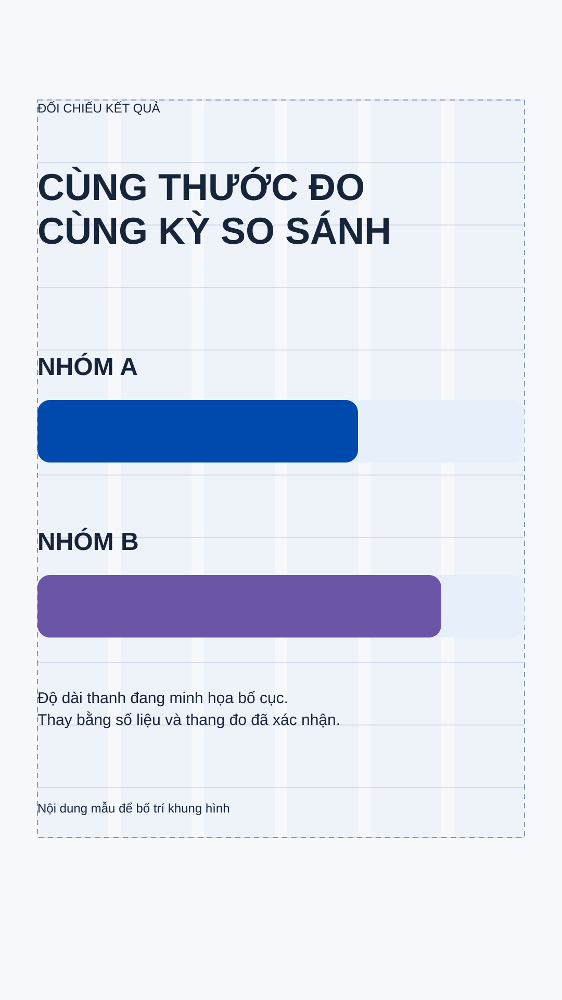
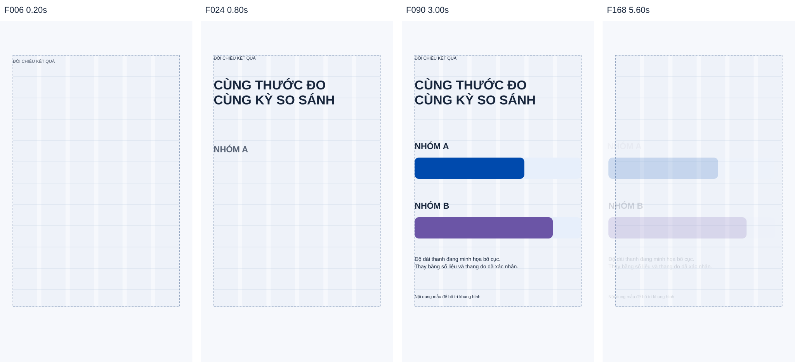

# L08 Horizontal Bar Comparison

So sánh hai giá trị trên cùng đơn vị và cùng thang đo.

- Profile P 1080 × 1920, 30 fps, 180 frame.
- Phong cách gợi ý: A01 / A02. Bố cục tham chiếu: B05.
- Tọa độ ở trạng thái đọc F090. Z tăng dần từ sau ra trước.

## Layer và vùng bố trí

| Z | Layer | Loại | x | y | w | h | Thông số | Màu token | Nội dung |
| --- | --- | --- | --- | --- | --- | --- | --- | --- | --- |
| 0 | TXT_EYEBROW | text | 72 | 192 | 936 | 48 | eyebrow: 24/36px, left | ink | ĐỐI CHIẾU KẾT QUẢ |
| 1 | TXT_HEAD | text | 72 | 312 | 936 | 264 | title: 72/84px, left | ink | CÙNG THƯỚC ĐO / CÙNG KỲ SO SÁNH |
| 2 | TXT_A_LABEL | text | 72 | 672 | 936 | 60 | card_title: 48/60px, left | ink | NHÓM A |
| 3 | SH_TRACK_A | shape | 72 | 768 | 936 | 120 | rect; radius 24px | tint | — |
| 4 | SH_VALUE_A | shape | 72 | 768 | 616 | 120 | rect; radius 24px | brand | — |
| 5 | TXT_B_LABEL | text | 72 | 1008 | 936 | 60 | card_title: 48/60px, left | ink | NHÓM B |
| 6 | SH_TRACK_B | shape | 72 | 1104 | 936 | 120 | rect; radius 24px | tint | — |
| 7 | SH_VALUE_B | shape | 72 | 1104 | 776 | 120 | rect; radius 24px | purple | — |
| 8 | TXT_NOTE | text | 72 | 1320 | 936 | 144 | small: 30/42px, left | ink | Độ dài thanh đang minh họa bố cục. / Thay bằng số liệu và thang đo đã xác nhận. |
| 9 | TXT_FOOT | text | 72 | 1536 | 936 | 60 | micro: 24/36px, left | ink | Nội dung mẫu để bố trí khung hình |

## Keyframe từng layer

| Layer | Preset | Bắt đầu | Đến đích | Ổn định | Ra hoặc giữ cuối |
| --- | --- | --- | --- | --- | --- |
| TXT_EYEBROW | M01 | F000: ΔP(0,+60), O0 | F018: ΔP(0,0), O100 | F024: ổn định | F150→F168: ΔP(0,0)→(-48,0), O100→0 |
| TXT_HEAD | M01 | F006: ΔP(0,+60), O0 | F024: ΔP(0,0), O100 | F030: ổn định | F152→F170: ΔP(0,0)→(-48,0), O100→0 |
| TXT_A_LABEL | M01 | F018: ΔP(0,+60), O0 | F036: ΔP(0,0), O100 | F042: ổn định | F156→F174: ΔP(0,0)→(-48,0), O100→0 |
| SH_TRACK_A | M02 | F024: S92%, O0 | F034: S103%, O100 | F042: S100%, O100 | F158→F176: ΔP(0,0)→(-48,0), O100→0 |
| SH_VALUE_A | M07 | F030: W=0, giữ đáy/trái | F054: W=616, O100 | F054: giữ kích thước | F160→F178: ΔP(0,0)→(-48,0), O100→0 |
| TXT_B_LABEL | M01 | F030: ΔP(0,+60), O0 | F048: ΔP(0,0), O100 | F054: ổn định | F160→F178: ΔP(0,0)→(-48,0), O100→0 |
| SH_TRACK_B | M02 | F036: S92%, O0 | F046: S103%, O100 | F054: S100%, O100 | F160→F178: ΔP(0,0)→(-48,0), O100→0 |
| SH_VALUE_B | M07 | F042: W=0, giữ đáy/trái | F066: W=776, O100 | F066: giữ kích thước | F160→F178: ΔP(0,0)→(-48,0), O100→0 |
| TXT_NOTE | M01 | F048: ΔP(0,+60), O0 | F066: ΔP(0,0), O100 | F072: ổn định | F160→F178: ΔP(0,0)→(-48,0), O100→0 |
| TXT_FOOT | M01 | F030: ΔP(0,+60), O0 | F048: ΔP(0,0), O100 | F054: ổn định | F160→F178: ΔP(0,0)→(-48,0), O100→0 |

## Bốn trạng thái motion

F006 vào, F024 dựng thông tin, F090 đọc, F168 ra hoặc giữ. Các hình minh họa được tính từ preset, không phải AE render.

## Ghi chú nội dung

Không dùng độ dài thanh tùy ý cho số thật. Bổ sung giá trị, đơn vị, kỳ và nguồn khi triển khai nội dung.

## Nối cảnh

E06: toàn bộ phần so sánh trượt ra theo một hướng.

## Khi thay nội dung

Đo lại độ rộng từng dòng với font thật. Giữ hierarchy, khoảng trống và vùng đọc. Nếu nội dung vượt ô, ưu tiên viết gọn, đổi line break hoặc tăng thời gian và tách cảnh. Không thu toàn bộ chữ đến mức khó đọc.
