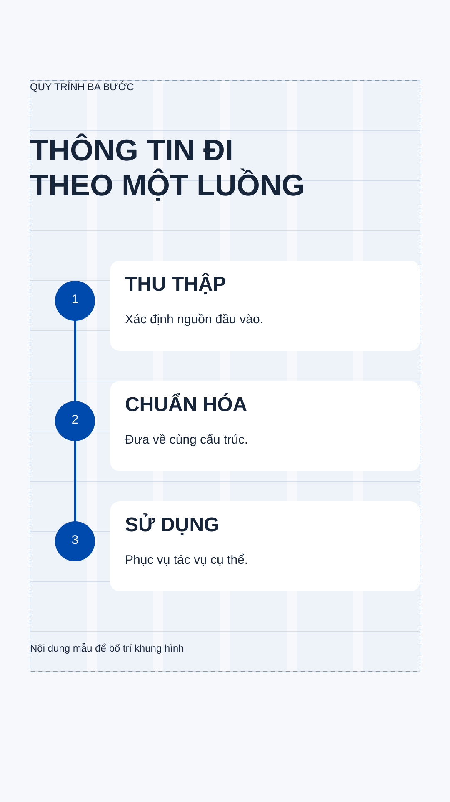
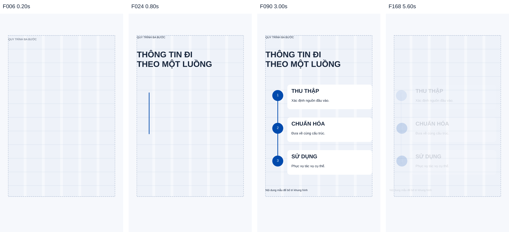
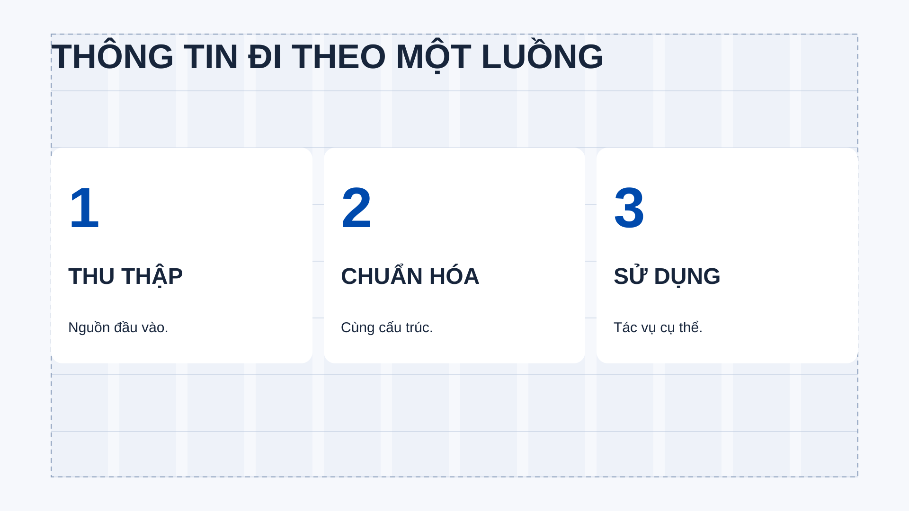

# L09 Vertical Three Step Flow

Giải thích một quy trình có thứ tự.

- Profile P 1080 × 1920, 30 fps, 180 frame.
- Phong cách gợi ý: A01 / A07. Bố cục tham chiếu: B06.
- Tọa độ ở trạng thái đọc F090. Z tăng dần từ sau ra trước.

## Layer và vùng bố trí

| Z | Layer | Loại | x | y | w | h | Thông số | Màu token | Nội dung |
| --- | --- | --- | --- | --- | --- | --- | --- | --- | --- |
| 0 | TXT_EYEBROW | text | 72 | 192 | 936 | 48 | eyebrow: 24/36px, left | ink | QUY TRÌNH BA BƯỚC |
| 1 | TXT_HEAD | text | 72 | 312 | 936 | 264 | title: 72/84px, left | ink | THÔNG TIN ĐI / THEO MỘT LUỒNG |
| 2 | SH_FLOW | line | 180 | 696 | 0 | 624 | Stroke 6px; [(180, 696), (180, 1320)] | brand | — |
| 3 | SH_STEP_1 | shape | 264 | 624 | 744 | 216 | rect; radius 24px | white | — |
| 4 | SH_DOT_1 | shape | 132 | 672 | 96 | 96 | circle; radius 24px | brand | — |
| 5 | TXT_NO_1 | text | 132 | 696 | 96 | 48 | small: 30/42px, center | white | 1 |
| 6 | TXT_STEP_HEAD_1 | text | 300 | 648 | 672 | 72 | card_title: 48/60px, left | ink | THU THẬP |
| 7 | TXT_STEP_BODY_1 | text | 300 | 744 | 672 | 60 | small: 30/42px, left | ink | Xác định nguồn đầu vào. |
| 8 | SH_STEP_2 | shape | 264 | 912 | 744 | 216 | rect; radius 24px | white | — |
| 9 | SH_DOT_2 | shape | 132 | 960 | 96 | 96 | circle; radius 24px | brand | — |
| 10 | TXT_NO_2 | text | 132 | 984 | 96 | 48 | small: 30/42px, center | white | 2 |
| 11 | TXT_STEP_HEAD_2 | text | 300 | 936 | 672 | 72 | card_title: 48/60px, left | ink | CHUẨN HÓA |
| 12 | TXT_STEP_BODY_2 | text | 300 | 1032 | 672 | 60 | small: 30/42px, left | ink | Đưa về cùng cấu trúc. |
| 13 | SH_STEP_3 | shape | 264 | 1200 | 744 | 216 | rect; radius 24px | white | — |
| 14 | SH_DOT_3 | shape | 132 | 1248 | 96 | 96 | circle; radius 24px | brand | — |
| 15 | TXT_NO_3 | text | 132 | 1272 | 96 | 48 | small: 30/42px, center | white | 3 |
| 16 | TXT_STEP_HEAD_3 | text | 300 | 1224 | 672 | 72 | card_title: 48/60px, left | ink | SỬ DỤNG |
| 17 | TXT_STEP_BODY_3 | text | 300 | 1320 | 672 | 60 | small: 30/42px, left | ink | Phục vụ tác vụ cụ thể. |
| 18 | TXT_FOOT | text | 72 | 1536 | 936 | 60 | micro: 24/36px, left | ink | Nội dung mẫu để bố trí khung hình |

## Keyframe từng layer

| Layer | Preset | Bắt đầu | Đến đích | Ổn định | Ra hoặc giữ cuối |
| --- | --- | --- | --- | --- | --- |
| TXT_EYEBROW | M01 | F000: ΔP(0,+60), O0 | F018: ΔP(0,0), O100 | F024: ổn định | F150→F168: ΔP(0,0)→(-48,0), O100→0 |
| TXT_HEAD | M01 | F006: ΔP(0,+60), O0 | F024: ΔP(0,0), O100 | F030: ổn định | F152→F170: ΔP(0,0)→(-48,0), O100→0 |
| SH_FLOW | M03 | F018: End0%, O100 | F042: End100%, O100 | F042: giữ nét | F156→F174: ΔP(0,0)→(-48,0), O100→0 |
| SH_STEP_1 | M02 | F024: S92%, O0 | F034: S103%, O100 | F042: S100%, O100 | F158→F176: ΔP(0,0)→(-48,0), O100→0 |
| SH_DOT_1 | M02 | F024: S92%, O0 | F034: S103%, O100 | F042: S100%, O100 | F158→F176: ΔP(0,0)→(-48,0), O100→0 |
| TXT_NO_1 | M01 | F030: ΔP(0,+60), O0 | F048: ΔP(0,0), O100 | F054: ổn định | F160→F178: ΔP(0,0)→(-48,0), O100→0 |
| TXT_STEP_HEAD_1 | M01 | F030: ΔP(0,+60), O0 | F048: ΔP(0,0), O100 | F054: ổn định | F160→F178: ΔP(0,0)→(-48,0), O100→0 |
| TXT_STEP_BODY_1 | M01 | F036: ΔP(0,+60), O0 | F054: ΔP(0,0), O100 | F060: ổn định | F160→F178: ΔP(0,0)→(-48,0), O100→0 |
| SH_STEP_2 | M02 | F030: S92%, O0 | F040: S103%, O100 | F048: S100%, O100 | F160→F178: ΔP(0,0)→(-48,0), O100→0 |
| SH_DOT_2 | M02 | F030: S92%, O0 | F040: S103%, O100 | F048: S100%, O100 | F160→F178: ΔP(0,0)→(-48,0), O100→0 |
| TXT_NO_2 | M01 | F036: ΔP(0,+60), O0 | F054: ΔP(0,0), O100 | F060: ổn định | F160→F178: ΔP(0,0)→(-48,0), O100→0 |
| TXT_STEP_HEAD_2 | M01 | F036: ΔP(0,+60), O0 | F054: ΔP(0,0), O100 | F060: ổn định | F160→F178: ΔP(0,0)→(-48,0), O100→0 |
| TXT_STEP_BODY_2 | M01 | F042: ΔP(0,+60), O0 | F060: ΔP(0,0), O100 | F066: ổn định | F160→F178: ΔP(0,0)→(-48,0), O100→0 |
| SH_STEP_3 | M02 | F036: S92%, O0 | F046: S103%, O100 | F054: S100%, O100 | F160→F178: ΔP(0,0)→(-48,0), O100→0 |
| SH_DOT_3 | M02 | F036: S92%, O0 | F046: S103%, O100 | F054: S100%, O100 | F160→F178: ΔP(0,0)→(-48,0), O100→0 |
| TXT_NO_3 | M01 | F042: ΔP(0,+60), O0 | F060: ΔP(0,0), O100 | F066: ổn định | F160→F178: ΔP(0,0)→(-48,0), O100→0 |
| TXT_STEP_HEAD_3 | M01 | F042: ΔP(0,+60), O0 | F060: ΔP(0,0), O100 | F066: ổn định | F160→F178: ΔP(0,0)→(-48,0), O100→0 |
| TXT_STEP_BODY_3 | M01 | F048: ΔP(0,+60), O0 | F066: ΔP(0,0), O100 | F072: ổn định | F160→F178: ΔP(0,0)→(-48,0), O100→0 |
| TXT_FOOT | M01 | F030: ΔP(0,+60), O0 | F048: ΔP(0,0), O100 | F054: ổn định | F160→F178: ΔP(0,0)→(-48,0), O100→0 |

## Bốn trạng thái motion

F006 vào, F024 dựng thông tin, F090 đọc, F168 ra hoặc giữ. Các hình minh họa được tính từ preset, không phải AE render.

## Ghi chú nội dung

Đường nối thể hiện trình tự. Voice cần nói theo thứ tự 1, 2, 3; không trình bày ba nhiệm vụ song song thành quy trình.

## Nối cảnh

E12: dẫn theo đường nối đến một cụm quy trình khác.

## Biến thể S Square

Đây là bố cục đã reflow với tọa độ riêng; motion entry dùng cùng preset và delay của layer.

| Z | Layer | Loại | x | y | w | h | Thông số | Màu token | Nội dung |
| --- | --- | --- | --- | --- | --- | --- | --- | --- | --- |
| 0 | TXT_HEAD | text | 72 | 72 | 936 | 168 | title: 72/84px, left | ink | THÔNG TIN ĐI / THEO MỘT LUỒNG |
| 1 | SH_CARD_1 | shape | 72 | 288 | 936 | 192 | rect; radius 24px | white | — |
| 2 | TXT_STEP_1 | text | 120 | 312 | 840 | 72 | card_title: 48/60px, left | ink | 1  THU THẬP |
| 3 | TXT_BODY_1 | text | 120 | 396 | 840 | 60 | small: 30/42px, left | ink | Nguồn đầu vào. |
| 4 | SH_CARD_2 | shape | 72 | 528 | 936 | 192 | rect; radius 24px | white | — |
| 5 | TXT_STEP_2 | text | 120 | 552 | 840 | 72 | card_title: 48/60px, left | ink | 2  CHUẨN HÓA |
| 6 | TXT_BODY_2 | text | 120 | 636 | 840 | 60 | small: 30/42px, left | ink | Cùng cấu trúc. |
| 7 | SH_CARD_3 | shape | 72 | 768 | 936 | 192 | rect; radius 24px | white | — |
| 8 | TXT_STEP_3 | text | 120 | 792 | 840 | 72 | card_title: 48/60px, left | ink | 3  SỬ DỤNG |
| 9 | TXT_BODY_3 | text | 120 | 876 | 840 | 60 | small: 30/42px, left | ink | Tác vụ cụ thể. |

## Biến thể L Landscape

Đây là bố cục đã reflow với tọa độ riêng; motion entry dùng cùng preset và delay của layer.

| Z | Layer | Loại | x | y | w | h | Thông số | Màu token | Nội dung |
| --- | --- | --- | --- | --- | --- | --- | --- | --- | --- |
| 0 | TXT_HEAD | text | 108 | 72 | 1704 | 96 | title: 72/84px, left | ink | THÔNG TIN ĐI THEO MỘT LUỒNG |
| 1 | SH_CARD_1 | shape | 108 | 312 | 552 | 456 | rect; radius 24px | white | — |
| 2 | TXT_STEP_NO_1 | text | 144 | 360 | 480 | 132 | number: 120/132px, left | brand | 1 |
| 3 | TXT_STEP_1 | text | 144 | 552 | 480 | 72 | card_title: 48/60px, left | ink | THU THẬP |
| 4 | TXT_BODY_1 | text | 144 | 672 | 480 | 60 | small: 30/42px, left | ink | Nguồn đầu vào. |
| 5 | SH_CARD_2 | shape | 684 | 312 | 552 | 456 | rect; radius 24px | white | — |
| 6 | TXT_STEP_NO_2 | text | 720 | 360 | 480 | 132 | number: 120/132px, left | brand | 2 |
| 7 | TXT_STEP_2 | text | 720 | 552 | 480 | 72 | card_title: 48/60px, left | ink | CHUẨN HÓA |
| 8 | TXT_BODY_2 | text | 720 | 672 | 480 | 60 | small: 30/42px, left | ink | Cùng cấu trúc. |
| 9 | SH_CARD_3 | shape | 1260 | 312 | 552 | 456 | rect; radius 24px | white | — |
| 10 | TXT_STEP_NO_3 | text | 1296 | 360 | 480 | 132 | number: 120/132px, left | brand | 3 |
| 11 | TXT_STEP_3 | text | 1296 | 552 | 480 | 72 | card_title: 48/60px, left | ink | SỬ DỤNG |
| 12 | TXT_BODY_3 | text | 1296 | 672 | 480 | 60 | small: 30/42px, left | ink | Tác vụ cụ thể. |

## Khi thay nội dung

Đo lại độ rộng từng dòng với font thật. Giữ hierarchy, khoảng trống và vùng đọc. Nếu nội dung vượt ô, ưu tiên viết gọn, đổi line break hoặc tăng thời gian và tách cảnh. Không thu toàn bộ chữ đến mức khó đọc.
