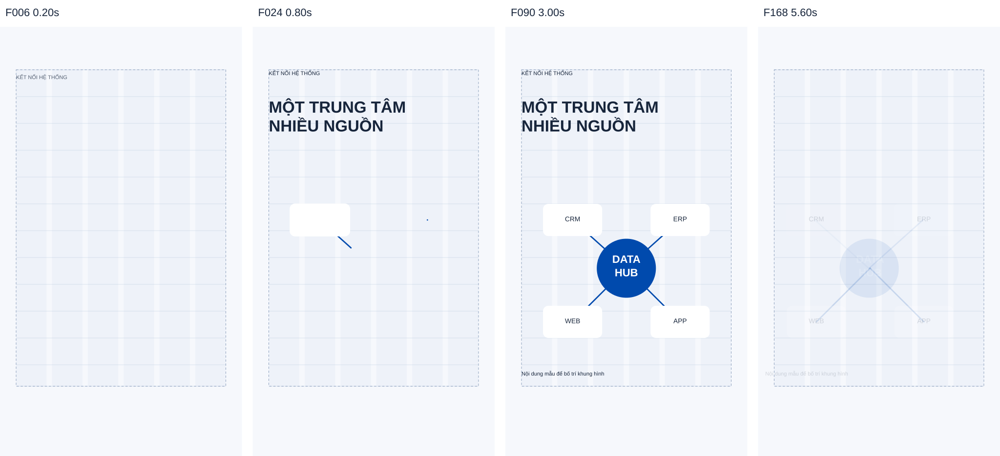

# L10 Hub And Spoke

Cho thấy các nguồn hoặc ứng dụng liên kết với thành phần trung tâm.

- Profile P 1080 × 1920, 30 fps, 180 frame.
- Phong cách gợi ý: A06 / A16. Bố cục tham chiếu: B07.
- Tọa độ ở trạng thái đọc F090. Z tăng dần từ sau ra trước.

## Layer và vùng bố trí

| Z | Layer | Loại | x | y | w | h | Thông số | Màu token | Nội dung |
| --- | --- | --- | --- | --- | --- | --- | --- | --- | --- |
| 0 | TXT_EYEBROW | text | 72 | 192 | 936 | 48 | eyebrow: 24/36px, left | ink | KẾT NỐI HỆ THỐNG |
| 1 | TXT_HEAD | text | 72 | 312 | 936 | 264 | title: 72/84px, left | ink | MỘT TRUNG TÂM / NHIỀU NGUỒN |
| 2 | SH_NET_A | line | 300 | 864 | 240 | 216 | Stroke 6px; [(300, 864), (540, 1080)] | brand | — |
| 3 | SH_NET_B | line | 540 | 864 | 240 | 216 | Stroke 6px; [(780, 864), (540, 1080)] | brand | — |
| 4 | SH_NET_C | line | 300 | 1080 | 240 | 240 | Stroke 6px; [(300, 1320), (540, 1080)] | brand | — |
| 5 | SH_NET_D | line | 540 | 1080 | 240 | 240 | Stroke 6px; [(780, 1320), (540, 1080)] | brand | — |
| 6 | SH_HUB | shape | 408 | 948 | 264 | 264 | circle; radius 24px | brand | — |
| 7 | TXT_HUB | text | 432 | 1008 | 216 | 120 | card_title: 48/60px, center | white | DATA / HUB |
| 8 | SH_NODE_1 | shape | 168 | 792 | 264 | 144 | rect; radius 24px | white | — |
| 9 | TXT_NODE_1 | text | 192 | 840 | 216 | 48 | small: 30/42px, center | ink | CRM |
| 10 | SH_NODE_2 | shape | 648 | 792 | 264 | 144 | rect; radius 24px | white | — |
| 11 | TXT_NODE_2 | text | 672 | 840 | 216 | 48 | small: 30/42px, center | ink | ERP |
| 12 | SH_NODE_3 | shape | 168 | 1248 | 264 | 144 | rect; radius 24px | white | — |
| 13 | TXT_NODE_3 | text | 192 | 1296 | 216 | 48 | small: 30/42px, center | ink | WEB |
| 14 | SH_NODE_4 | shape | 648 | 1248 | 264 | 144 | rect; radius 24px | white | — |
| 15 | TXT_NODE_4 | text | 672 | 1296 | 216 | 48 | small: 30/42px, center | ink | APP |
| 16 | TXT_FOOT | text | 72 | 1536 | 936 | 60 | micro: 24/36px, left | ink | Nội dung mẫu để bố trí khung hình |

## Keyframe từng layer

| Layer | Preset | Bắt đầu | Đến đích | Ổn định | Ra hoặc giữ cuối |
| --- | --- | --- | --- | --- | --- |
| TXT_EYEBROW | M01 | F000: ΔP(0,+60), O0 | F018: ΔP(0,0), O100 | F024: ổn định | F150→F168: ΔP(0,0)→(-48,0), O100→0 |
| TXT_HEAD | M01 | F006: ΔP(0,+60), O0 | F024: ΔP(0,0), O100 | F030: ổn định | F152→F170: ΔP(0,0)→(-48,0), O100→0 |
| SH_NET_A | M03 | F018: End0%, O100 | F042: End100%, O100 | F042: giữ nét | F156→F174: ΔP(0,0)→(-48,0), O100→0 |
| SH_NET_B | M03 | F024: End0%, O100 | F048: End100%, O100 | F048: giữ nét | F158→F176: ΔP(0,0)→(-48,0), O100→0 |
| SH_NET_C | M03 | F030: End0%, O100 | F054: End100%, O100 | F054: giữ nét | F160→F178: ΔP(0,0)→(-48,0), O100→0 |
| SH_NET_D | M03 | F036: End0%, O100 | F060: End100%, O100 | F060: giữ nét | F160→F178: ΔP(0,0)→(-48,0), O100→0 |
| SH_HUB | M02 | F024: S92%, O0 | F034: S103%, O100 | F042: S100%, O100 | F158→F176: ΔP(0,0)→(-48,0), O100→0 |
| TXT_HUB | M01 | F036: ΔP(0,+60), O0 | F054: ΔP(0,0), O100 | F060: ổn định | F160→F178: ΔP(0,0)→(-48,0), O100→0 |
| SH_NODE_1 | M02 | F018: S92%, O0 | F028: S103%, O100 | F036: S100%, O100 | F156→F174: ΔP(0,0)→(-48,0), O100→0 |
| TXT_NODE_1 | M01 | F030: ΔP(0,+60), O0 | F048: ΔP(0,0), O100 | F054: ổn định | F160→F178: ΔP(0,0)→(-48,0), O100→0 |
| SH_NODE_2 | M02 | F024: S92%, O0 | F034: S103%, O100 | F042: S100%, O100 | F158→F176: ΔP(0,0)→(-48,0), O100→0 |
| TXT_NODE_2 | M01 | F036: ΔP(0,+60), O0 | F054: ΔP(0,0), O100 | F060: ổn định | F160→F178: ΔP(0,0)→(-48,0), O100→0 |
| SH_NODE_3 | M02 | F030: S92%, O0 | F040: S103%, O100 | F048: S100%, O100 | F160→F178: ΔP(0,0)→(-48,0), O100→0 |
| TXT_NODE_3 | M01 | F042: ΔP(0,+60), O0 | F060: ΔP(0,0), O100 | F066: ổn định | F160→F178: ΔP(0,0)→(-48,0), O100→0 |
| SH_NODE_4 | M02 | F036: S92%, O0 | F046: S103%, O100 | F054: S100%, O100 | F160→F178: ΔP(0,0)→(-48,0), O100→0 |
| TXT_NODE_4 | M01 | F048: ΔP(0,+60), O0 | F066: ΔP(0,0), O100 | F072: ổn định | F160→F178: ΔP(0,0)→(-48,0), O100→0 |
| TXT_FOOT | M01 | F030: ΔP(0,+60), O0 | F048: ΔP(0,0), O100 | F054: ổn định | F160→F178: ΔP(0,0)→(-48,0), O100→0 |

## Bốn trạng thái motion

F006 vào, F024 dựng thông tin, F090 đọc, F168 ra hoặc giữ. Các hình minh họa được tính từ preset, không phải AE render.

## Ghi chú nội dung

Sơ đồ minh họa quan hệ kết nối. Chỉ vẽ mũi tên một hoặc hai chiều khi đã xác nhận hướng trao đổi dữ liệu.

## Nối cảnh

E04: zoom vào hub để mở cảnh tính năng.

## Khi thay nội dung

Đo lại độ rộng từng dòng với font thật. Giữ hierarchy, khoảng trống và vùng đọc. Nếu nội dung vượt ô, ưu tiên viết gọn, đổi line break hoặc tăng thời gian và tách cảnh. Không thu toàn bộ chữ đến mức khó đọc.
