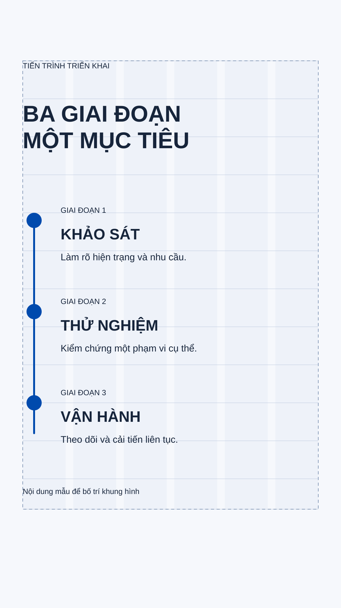
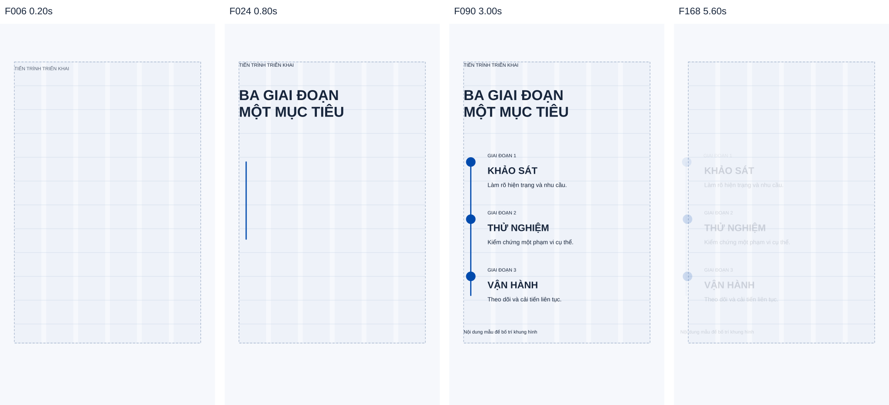

# L12 Milestone Timeline

Đưa các giai đoạn theo trật tự thời gian.

- Profile P 1080 × 1920, 30 fps, 180 frame.
- Phong cách gợi ý: A01 / A04. Bố cục tham chiếu: B06.
- Tọa độ ở trạng thái đọc F090. Z tăng dần từ sau ra trước.

## Layer và vùng bố trí

| Z | Layer | Loại | x | y | w | h | Thông số | Màu token | Nội dung |
| --- | --- | --- | --- | --- | --- | --- | --- | --- | --- |
| 0 | TXT_EYEBROW | text | 72 | 192 | 936 | 48 | eyebrow: 24/36px, left | ink | TIẾN TRÌNH TRIỂN KHAI |
| 1 | TXT_HEAD | text | 72 | 312 | 936 | 264 | title: 72/84px, left | ink | BA GIAI ĐOẠN / MỘT MỤC TIÊU |
| 2 | SH_TIMELINE | line | 108 | 696 | 0 | 672 | Stroke 6px; [(108, 696), (108, 1368)] | brand | — |
| 3 | SH_MARK_1 | shape | 84 | 672 | 48 | 48 | circle; radius 24px | brand | — |
| 4 | TXT_PHASE_1 | text | 192 | 648 | 816 | 48 | micro: 24/36px, left | ink | GIAI ĐOẠN 1 |
| 5 | TXT_PHASE_HEAD_1 | text | 192 | 708 | 816 | 72 | card_title: 48/60px, left | ink | KHẢO SÁT |
| 6 | TXT_PHASE_BODY_1 | text | 192 | 792 | 816 | 96 | small: 30/42px, left | ink | Làm rõ hiện trạng và nhu cầu. |
| 7 | SH_MARK_2 | shape | 84 | 960 | 48 | 48 | circle; radius 24px | brand | — |
| 8 | TXT_PHASE_2 | text | 192 | 936 | 816 | 48 | micro: 24/36px, left | ink | GIAI ĐOẠN 2 |
| 9 | TXT_PHASE_HEAD_2 | text | 192 | 996 | 816 | 72 | card_title: 48/60px, left | ink | THỬ NGHIỆM |
| 10 | TXT_PHASE_BODY_2 | text | 192 | 1080 | 816 | 96 | small: 30/42px, left | ink | Kiểm chứng một phạm vi cụ thể. |
| 11 | SH_MARK_3 | shape | 84 | 1248 | 48 | 48 | circle; radius 24px | brand | — |
| 12 | TXT_PHASE_3 | text | 192 | 1224 | 816 | 48 | micro: 24/36px, left | ink | GIAI ĐOẠN 3 |
| 13 | TXT_PHASE_HEAD_3 | text | 192 | 1284 | 816 | 72 | card_title: 48/60px, left | ink | VẬN HÀNH |
| 14 | TXT_PHASE_BODY_3 | text | 192 | 1368 | 816 | 96 | small: 30/42px, left | ink | Theo dõi và cải tiến liên tục. |
| 15 | TXT_FOOT | text | 72 | 1536 | 936 | 60 | micro: 24/36px, left | ink | Nội dung mẫu để bố trí khung hình |

## Keyframe từng layer

| Layer | Preset | Bắt đầu | Đến đích | Ổn định | Ra hoặc giữ cuối |
| --- | --- | --- | --- | --- | --- |
| TXT_EYEBROW | M01 | F000: ΔP(0,+60), O0 | F018: ΔP(0,0), O100 | F024: ổn định | F150→F168: ΔP(0,0)→(-48,0), O100→0 |
| TXT_HEAD | M01 | F006: ΔP(0,+60), O0 | F024: ΔP(0,0), O100 | F030: ổn định | F152→F170: ΔP(0,0)→(-48,0), O100→0 |
| SH_TIMELINE | M03 | F018: End0%, O100 | F042: End100%, O100 | F042: giữ nét | F156→F174: ΔP(0,0)→(-48,0), O100→0 |
| SH_MARK_1 | M02 | F024: S92%, O0 | F034: S103%, O100 | F042: S100%, O100 | F158→F176: ΔP(0,0)→(-48,0), O100→0 |
| TXT_PHASE_1 | M01 | F024: ΔP(0,+60), O0 | F042: ΔP(0,0), O100 | F048: ổn định | F158→F176: ΔP(0,0)→(-48,0), O100→0 |
| TXT_PHASE_HEAD_1 | M01 | F030: ΔP(0,+60), O0 | F048: ΔP(0,0), O100 | F054: ổn định | F160→F178: ΔP(0,0)→(-48,0), O100→0 |
| TXT_PHASE_BODY_1 | M01 | F036: ΔP(0,+60), O0 | F054: ΔP(0,0), O100 | F060: ổn định | F160→F178: ΔP(0,0)→(-48,0), O100→0 |
| SH_MARK_2 | M02 | F030: S92%, O0 | F040: S103%, O100 | F048: S100%, O100 | F160→F178: ΔP(0,0)→(-48,0), O100→0 |
| TXT_PHASE_2 | M01 | F030: ΔP(0,+60), O0 | F048: ΔP(0,0), O100 | F054: ổn định | F160→F178: ΔP(0,0)→(-48,0), O100→0 |
| TXT_PHASE_HEAD_2 | M01 | F036: ΔP(0,+60), O0 | F054: ΔP(0,0), O100 | F060: ổn định | F160→F178: ΔP(0,0)→(-48,0), O100→0 |
| TXT_PHASE_BODY_2 | M01 | F042: ΔP(0,+60), O0 | F060: ΔP(0,0), O100 | F066: ổn định | F160→F178: ΔP(0,0)→(-48,0), O100→0 |
| SH_MARK_3 | M02 | F036: S92%, O0 | F046: S103%, O100 | F054: S100%, O100 | F160→F178: ΔP(0,0)→(-48,0), O100→0 |
| TXT_PHASE_3 | M01 | F036: ΔP(0,+60), O0 | F054: ΔP(0,0), O100 | F060: ổn định | F160→F178: ΔP(0,0)→(-48,0), O100→0 |
| TXT_PHASE_HEAD_3 | M01 | F042: ΔP(0,+60), O0 | F060: ΔP(0,0), O100 | F066: ổn định | F160→F178: ΔP(0,0)→(-48,0), O100→0 |
| TXT_PHASE_BODY_3 | M01 | F048: ΔP(0,+60), O0 | F066: ΔP(0,0), O100 | F072: ổn định | F160→F178: ΔP(0,0)→(-48,0), O100→0 |
| TXT_FOOT | M01 | F030: ΔP(0,+60), O0 | F048: ΔP(0,0), O100 | F054: ổn định | F160→F178: ΔP(0,0)→(-48,0), O100→0 |

## Bốn trạng thái motion

F006 vào, F024 dựng thông tin, F090 đọc, F168 ra hoặc giữ. Các hình minh họa được tính từ preset, không phải AE render.

## Ghi chú nội dung

Thay nhãn giai đoạn bằng thời gian thật khi cần. Khoảng cách đang theo bố cục, không biểu diễn tỷ lệ thời gian.

## Nối cảnh

E12: di chuyển dọc timeline tới cột mốc tiếp theo.

## Khi thay nội dung

Đo lại độ rộng từng dòng với font thật. Giữ hierarchy, khoảng trống và vùng đọc. Nếu nội dung vượt ô, ưu tiên viết gọn, đổi line break hoặc tăng thời gian và tách cảnh. Không thu toàn bộ chữ đến mức khó đọc.
