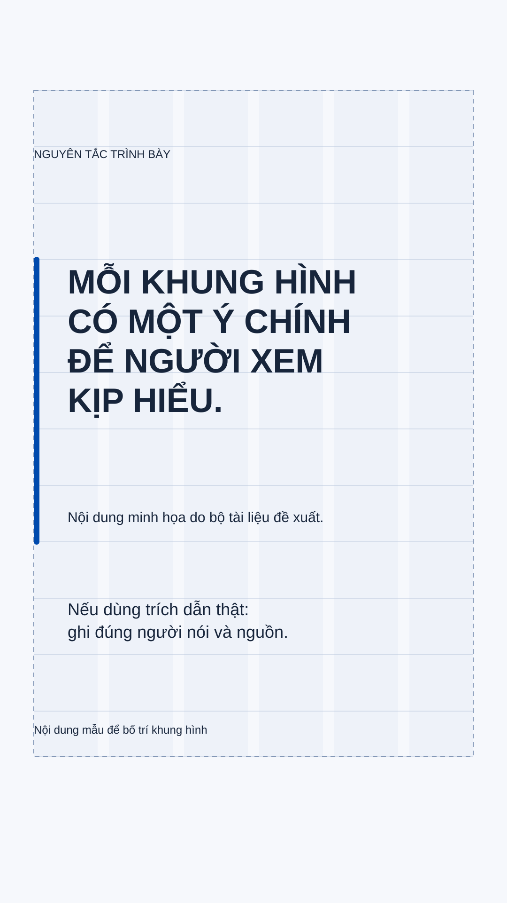
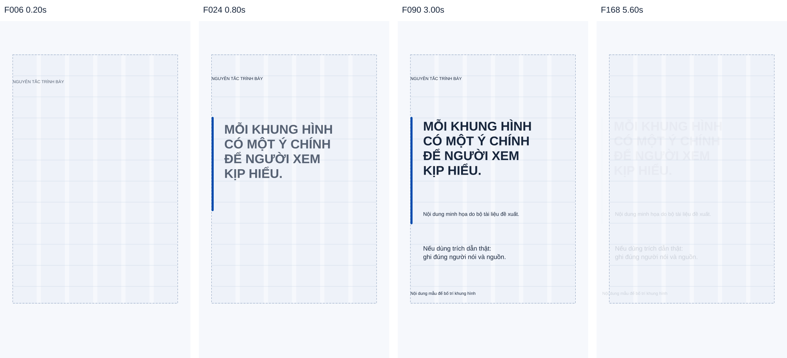

# L13 Quote Or Principle

Đặt một nhận định hoặc nguyên tắc làm trọng tâm.

- Profile P 1080 × 1920, 30 fps, 180 frame.
- Phong cách gợi ý: A04 / A01. Bố cục tham chiếu: B01.
- Tọa độ ở trạng thái đọc F090. Z tăng dần từ sau ra trước.

## Layer và vùng bố trí

| Z | Layer | Loại | x | y | w | h | Thông số | Màu token | Nội dung |
| --- | --- | --- | --- | --- | --- | --- | --- | --- | --- |
| 0 | TXT_EYEBROW | text | 72 | 312 | 936 | 48 | eyebrow: 24/36px, left | ink | NGUYÊN TẮC TRÌNH BÀY |
| 1 | SH_QUOTE_LINE | line | 78 | 552 | 0 | 600 | Stroke 12px; [(78, 552), (78, 1152)] | brand | — |
| 2 | TXT_QUOTE | text | 144 | 552 | 864 | 384 | title: 72/84px, left | ink | MỖI KHUNG HÌNH / CÓ MỘT Ý CHÍNH / ĐỂ NGƯỜI XEM / KỊP HIỂU. |
| 3 | TXT_ATTRIBUTION | text | 144 | 1080 | 864 | 96 | small: 30/42px, left | ink | Nội dung minh họa do bộ tài liệu đề xuất. |
| 4 | TXT_SUPPORT | text | 144 | 1272 | 864 | 144 | body: 36/48px, left | ink | Nếu dùng trích dẫn thật: / ghi đúng người nói và nguồn. |
| 5 | TXT_FOOT | text | 72 | 1536 | 936 | 60 | micro: 24/36px, left | ink | Nội dung mẫu để bố trí khung hình |

## Keyframe từng layer

| Layer | Preset | Bắt đầu | Đến đích | Ổn định | Ra hoặc giữ cuối |
| --- | --- | --- | --- | --- | --- |
| TXT_EYEBROW | M01 | F000: ΔP(0,+60), O0 | F018: ΔP(0,0), O100 | F024: ổn định | F150→F168: ΔP(0,0)→(-48,0), O100→0 |
| SH_QUOTE_LINE | M03 | F012: End0%, O100 | F036: End100%, O100 | F036: giữ nét | F154→F172: ΔP(0,0)→(-48,0), O100→0 |
| TXT_QUOTE | M01 | F018: ΔP(0,+60), O0 | F036: ΔP(0,0), O100 | F042: ổn định | F156→F174: ΔP(0,0)→(-48,0), O100→0 |
| TXT_ATTRIBUTION | M01 | F030: ΔP(0,+60), O0 | F048: ΔP(0,0), O100 | F054: ổn định | F160→F178: ΔP(0,0)→(-48,0), O100→0 |
| TXT_SUPPORT | M01 | F036: ΔP(0,+60), O0 | F054: ΔP(0,0), O100 | F060: ổn định | F160→F178: ΔP(0,0)→(-48,0), O100→0 |
| TXT_FOOT | M01 | F030: ΔP(0,+60), O0 | F048: ΔP(0,0), O100 | F054: ổn định | F160→F178: ΔP(0,0)→(-48,0), O100→0 |

## Bốn trạng thái motion

F006 vào, F024 dựng thông tin, F090 đọc, F168 ra hoặc giữ. Các hình minh họa được tính từ preset, không phải AE render.

## Ghi chú nội dung

Đây là nguyên tắc biên soạn, không phải trích dẫn của một nhân vật. Chữ dài phải tăng thời gian giữ.

## Nối cảnh

E02: giữ một từ khóa khớp vị trí với câu mở đầu cảnh sau.

## Khi thay nội dung

Đo lại độ rộng từng dòng với font thật. Giữ hierarchy, khoảng trống và vùng đọc. Nếu nội dung vượt ô, ưu tiên viết gọn, đổi line break hoặc tăng thời gian và tách cảnh. Không thu toàn bộ chữ đến mức khó đọc.
