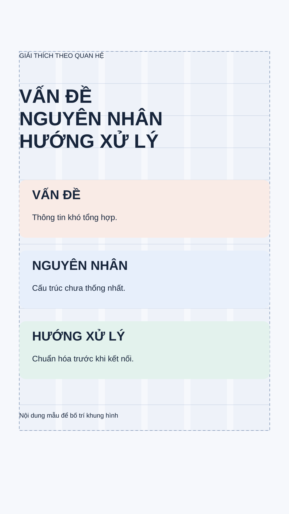
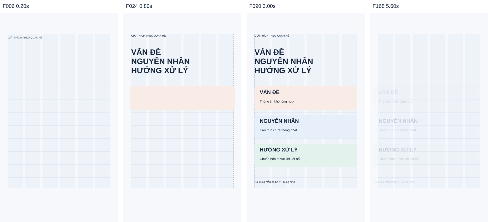

# L14 Problem Cause Solution

Liên kết một vấn đề với nguyên nhân và hướng xử lý.

- Profile P 1080 × 1920, 30 fps, 180 frame.
- Phong cách gợi ý: A01 / A05. Bố cục tham chiếu: B06.
- Tọa độ ở trạng thái đọc F090. Z tăng dần từ sau ra trước.

## Layer và vùng bố trí

| Z | Layer | Loại | x | y | w | h | Thông số | Màu token | Nội dung |
| --- | --- | --- | --- | --- | --- | --- | --- | --- | --- |
| 0 | TXT_EYEBROW | text | 72 | 192 | 936 | 48 | eyebrow: 24/36px, left | ink | GIẢI THÍCH THEO QUAN HỆ |
| 1 | TXT_HEAD | text | 72 | 312 | 936 | 264 | title: 72/84px, left | ink | VẤN ĐỀ / NGUYÊN NHÂN / HƯỚNG XỬ LÝ |
| 2 | SH_PANEL_1 | shape | 72 | 672 | 936 | 216 | rect; radius 24px | warm_tint | — |
| 3 | TXT_PANEL_HEAD_1 | text | 120 | 696 | 840 | 72 | card_title: 48/60px, left | ink | VẤN ĐỀ |
| 4 | TXT_PANEL_BODY_1 | text | 120 | 792 | 840 | 60 | small: 30/42px, left | ink | Thông tin khó tổng hợp. |
| 5 | SH_PANEL_2 | shape | 72 | 936 | 936 | 216 | rect; radius 24px | tint | — |
| 6 | TXT_PANEL_HEAD_2 | text | 120 | 960 | 840 | 72 | card_title: 48/60px, left | ink | NGUYÊN NHÂN |
| 7 | TXT_PANEL_BODY_2 | text | 120 | 1056 | 840 | 60 | small: 30/42px, left | ink | Cấu trúc chưa thống nhất. |
| 8 | SH_PANEL_3 | shape | 72 | 1200 | 936 | 216 | rect; radius 24px | green_tint | — |
| 9 | TXT_PANEL_HEAD_3 | text | 120 | 1224 | 840 | 72 | card_title: 48/60px, left | ink | HƯỚNG XỬ LÝ |
| 10 | TXT_PANEL_BODY_3 | text | 120 | 1320 | 840 | 60 | small: 30/42px, left | ink | Chuẩn hóa trước khi kết nối. |
| 11 | TXT_FOOT | text | 72 | 1536 | 936 | 60 | micro: 24/36px, left | ink | Nội dung mẫu để bố trí khung hình |

## Keyframe từng layer

| Layer | Preset | Bắt đầu | Đến đích | Ổn định | Ra hoặc giữ cuối |
| --- | --- | --- | --- | --- | --- |
| TXT_EYEBROW | M01 | F000: ΔP(0,+60), O0 | F018: ΔP(0,0), O100 | F024: ổn định | F150→F168: ΔP(0,0)→(-48,0), O100→0 |
| TXT_HEAD | M01 | F006: ΔP(0,+60), O0 | F024: ΔP(0,0), O100 | F030: ổn định | F152→F170: ΔP(0,0)→(-48,0), O100→0 |
| SH_PANEL_1 | M02 | F018: S92%, O0 | F028: S103%, O100 | F036: S100%, O100 | F156→F174: ΔP(0,0)→(-48,0), O100→0 |
| TXT_PANEL_HEAD_1 | M01 | F024: ΔP(0,+60), O0 | F042: ΔP(0,0), O100 | F048: ổn định | F158→F176: ΔP(0,0)→(-48,0), O100→0 |
| TXT_PANEL_BODY_1 | M01 | F030: ΔP(0,+60), O0 | F048: ΔP(0,0), O100 | F054: ổn định | F160→F178: ΔP(0,0)→(-48,0), O100→0 |
| SH_PANEL_2 | M02 | F024: S92%, O0 | F034: S103%, O100 | F042: S100%, O100 | F158→F176: ΔP(0,0)→(-48,0), O100→0 |
| TXT_PANEL_HEAD_2 | M01 | F030: ΔP(0,+60), O0 | F048: ΔP(0,0), O100 | F054: ổn định | F160→F178: ΔP(0,0)→(-48,0), O100→0 |
| TXT_PANEL_BODY_2 | M01 | F036: ΔP(0,+60), O0 | F054: ΔP(0,0), O100 | F060: ổn định | F160→F178: ΔP(0,0)→(-48,0), O100→0 |
| SH_PANEL_3 | M02 | F030: S92%, O0 | F040: S103%, O100 | F048: S100%, O100 | F160→F178: ΔP(0,0)→(-48,0), O100→0 |
| TXT_PANEL_HEAD_3 | M01 | F036: ΔP(0,+60), O0 | F054: ΔP(0,0), O100 | F060: ổn định | F160→F178: ΔP(0,0)→(-48,0), O100→0 |
| TXT_PANEL_BODY_3 | M01 | F042: ΔP(0,+60), O0 | F060: ΔP(0,0), O100 | F066: ổn định | F160→F178: ΔP(0,0)→(-48,0), O100→0 |
| TXT_FOOT | M01 | F030: ΔP(0,+60), O0 | F048: ΔP(0,0), O100 | F054: ổn định | F160→F178: ΔP(0,0)→(-48,0), O100→0 |

## Bốn trạng thái motion

F006 vào, F024 dựng thông tin, F090 đọc, F168 ra hoặc giữ. Các hình minh họa được tính từ preset, không phải AE render.

## Ghi chú nội dung

Nguyên nhân trong mẫu là minh họa, phải thay bằng nhận định có căn cứ của nội dung thật.

## Nối cảnh

E04: mở rộng panel hướng xử lý thành cảnh giải thích sâu hơn.

## Khi thay nội dung

Đo lại độ rộng từng dòng với font thật. Giữ hierarchy, khoảng trống và vùng đọc. Nếu nội dung vượt ô, ưu tiên viết gọn, đổi line break hoặc tăng thời gian và tách cảnh. Không thu toàn bộ chữ đến mức khó đọc.
