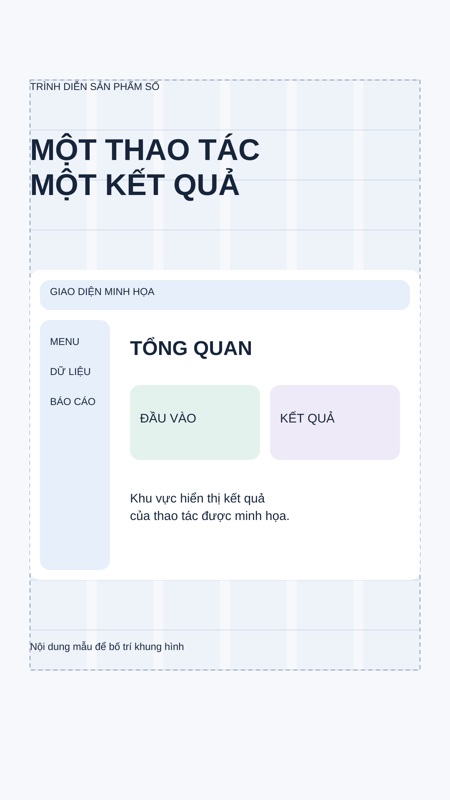
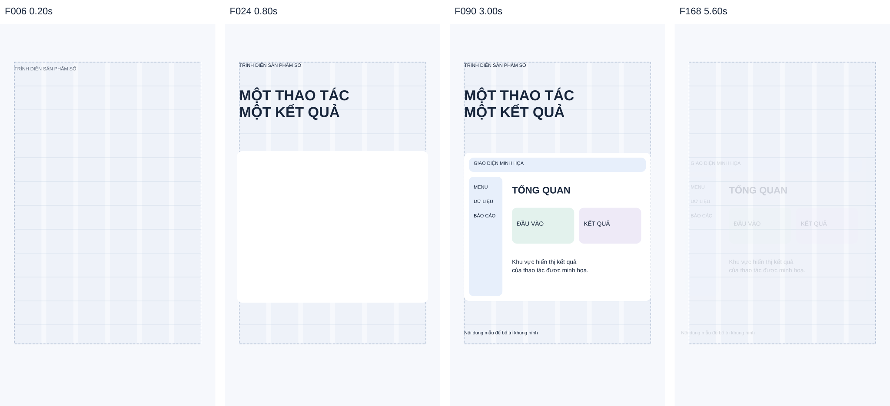
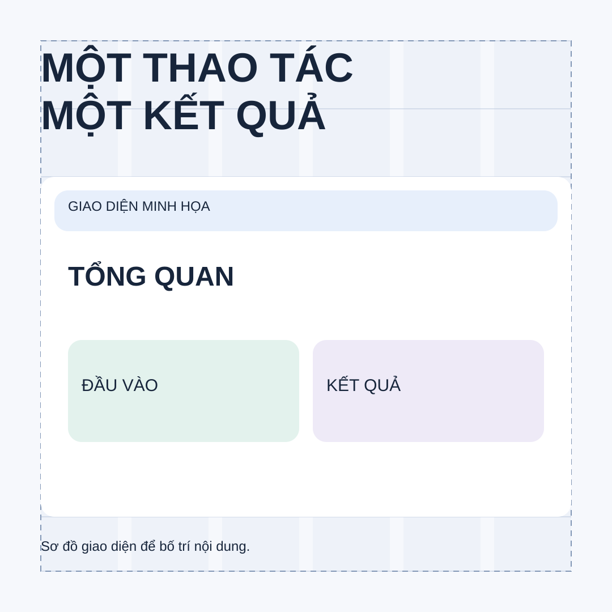
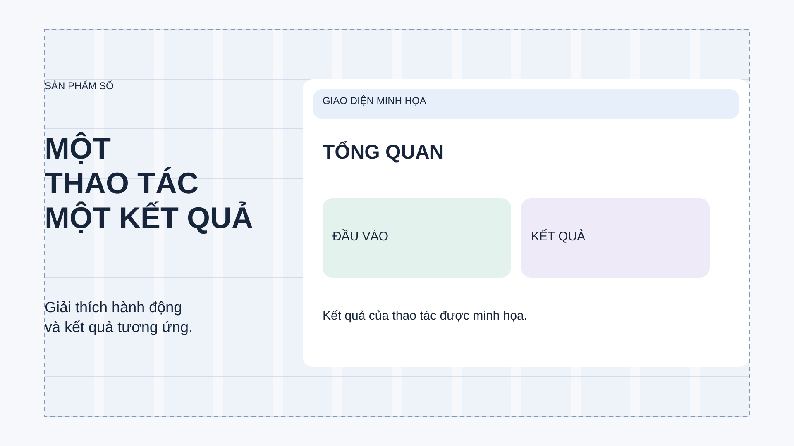

# L15 UI Product Panel

Giới thiệu một thao tác và kết quả trong một giao diện.

- Profile P 1080 × 1920, 30 fps, 180 frame.
- Phong cách gợi ý: A01 / A15. Bố cục tham chiếu: B03.
- Tọa độ ở trạng thái đọc F090. Z tăng dần từ sau ra trước.

## Layer và vùng bố trí

| Z | Layer | Loại | x | y | w | h | Thông số | Màu token | Nội dung |
| --- | --- | --- | --- | --- | --- | --- | --- | --- | --- |
| 0 | TXT_EYEBROW | text | 72 | 192 | 936 | 48 | eyebrow: 24/36px, left | ink | TRÌNH DIỄN SẢN PHẨM SỐ |
| 1 | TXT_HEAD | text | 72 | 312 | 936 | 264 | title: 72/84px, left | ink | MỘT THAO TÁC / MỘT KẾT QUẢ |
| 2 | SH_UI_PANEL | shape | 72 | 648 | 936 | 744 | rect; radius 24px | white | — |
| 3 | SH_UI_TOPBAR | shape | 96 | 672 | 888 | 72 | rect; radius 24px | tint | — |
| 4 | TXT_UI_TOP | text | 120 | 684 | 840 | 48 | micro: 24/36px, left | ink | GIAO DIỆN MINH HỌA |
| 5 | SH_UI_SIDE | shape | 96 | 768 | 168 | 600 | rect; radius 24px | tint | — |
| 6 | TXT_UI_NAV | text | 120 | 804 | 120 | 336 | micro: 24/36px, left | ink | MENU /  / DỮ LIỆU /  / BÁO CÁO |
| 7 | TXT_UI_HEADING | text | 312 | 804 | 648 | 72 | card_title: 48/60px, left | ink | TỔNG QUAN |
| 8 | SH_UI_TILE_A | shape | 312 | 924 | 312 | 180 | rect; radius 24px | green_tint | — |
| 9 | SH_UI_TILE_B | shape | 648 | 924 | 312 | 180 | rect; radius 24px | purple_tint | — |
| 10 | TXT_UI_A | text | 336 | 984 | 264 | 60 | small: 30/42px, left | ink | ĐẦU VÀO |
| 11 | TXT_UI_B | text | 672 | 984 | 264 | 60 | small: 30/42px, left | ink | KẾT QUẢ |
| 12 | TXT_UI_NOTE | text | 312 | 1176 | 648 | 144 | small: 30/42px, left | ink | Khu vực hiển thị kết quả / của thao tác được minh họa. |
| 13 | TXT_FOOT | text | 72 | 1536 | 936 | 60 | micro: 24/36px, left | ink | Nội dung mẫu để bố trí khung hình |

## Keyframe từng layer

| Layer | Preset | Bắt đầu | Đến đích | Ổn định | Ra hoặc giữ cuối |
| --- | --- | --- | --- | --- | --- |
| TXT_EYEBROW | M01 | F000: ΔP(0,+60), O0 | F018: ΔP(0,0), O100 | F024: ổn định | F150→F168: ΔP(0,0)→(-48,0), O100→0 |
| TXT_HEAD | M01 | F006: ΔP(0,+60), O0 | F024: ΔP(0,0), O100 | F030: ổn định | F152→F170: ΔP(0,0)→(-48,0), O100→0 |
| SH_UI_PANEL | M02 | F018: S92%, O0 | F028: S103%, O100 | F036: S100%, O100 | F156→F174: ΔP(0,0)→(-48,0), O100→0 |
| SH_UI_TOPBAR | M02 | F024: S92%, O0 | F034: S103%, O100 | F042: S100%, O100 | F158→F176: ΔP(0,0)→(-48,0), O100→0 |
| TXT_UI_TOP | M01 | F030: ΔP(0,+60), O0 | F048: ΔP(0,0), O100 | F054: ổn định | F160→F178: ΔP(0,0)→(-48,0), O100→0 |
| SH_UI_SIDE | M02 | F024: S92%, O0 | F034: S103%, O100 | F042: S100%, O100 | F158→F176: ΔP(0,0)→(-48,0), O100→0 |
| TXT_UI_NAV | M01 | F036: ΔP(0,+60), O0 | F054: ΔP(0,0), O100 | F060: ổn định | F160→F178: ΔP(0,0)→(-48,0), O100→0 |
| TXT_UI_HEADING | M01 | F036: ΔP(0,+60), O0 | F054: ΔP(0,0), O100 | F060: ổn định | F160→F178: ΔP(0,0)→(-48,0), O100→0 |
| SH_UI_TILE_A | M02 | F030: S92%, O0 | F040: S103%, O100 | F048: S100%, O100 | F160→F178: ΔP(0,0)→(-48,0), O100→0 |
| SH_UI_TILE_B | M02 | F036: S92%, O0 | F046: S103%, O100 | F054: S100%, O100 | F160→F178: ΔP(0,0)→(-48,0), O100→0 |
| TXT_UI_A | M01 | F042: ΔP(0,+60), O0 | F060: ΔP(0,0), O100 | F066: ổn định | F160→F178: ΔP(0,0)→(-48,0), O100→0 |
| TXT_UI_B | M01 | F048: ΔP(0,+60), O0 | F066: ΔP(0,0), O100 | F072: ổn định | F160→F178: ΔP(0,0)→(-48,0), O100→0 |
| TXT_UI_NOTE | M01 | F048: ΔP(0,+60), O0 | F066: ΔP(0,0), O100 | F072: ổn định | F160→F178: ΔP(0,0)→(-48,0), O100→0 |
| TXT_FOOT | M01 | F030: ΔP(0,+60), O0 | F048: ΔP(0,0), O100 | F054: ổn định | F160→F178: ΔP(0,0)→(-48,0), O100→0 |

## Bốn trạng thái motion

F006 vào, F024 dựng thông tin, F090 đọc, F168 ra hoặc giữ. Các hình minh họa được tính từ preset, không phải AE render.

## Ghi chú nội dung

Đây là sơ đồ giao diện, không phải screenshot sản phẩm thật. Dùng giao diện thật đã được phép khi làm demo tính năng.

## Nối cảnh

E04: đi vào vùng kết quả; không zoom đến mức chữ mất nét hoặc quá nhỏ.

## Biến thể S Square

Đây là bố cục đã reflow với tọa độ riêng; motion entry dùng cùng preset và delay của layer.

| Z | Layer | Loại | x | y | w | h | Thông số | Màu token | Nội dung |
| --- | --- | --- | --- | --- | --- | --- | --- | --- | --- |
| 0 | TXT_HEAD | text | 72 | 72 | 936 | 168 | title: 72/84px, left | ink | MỘT THAO TÁC / MỘT KẾT QUẢ |
| 1 | SH_UI_PANEL | shape | 72 | 312 | 936 | 600 | rect; radius 24px | white | — |
| 2 | SH_UI_BAR | shape | 96 | 336 | 888 | 72 | rect; radius 24px | tint | — |
| 3 | TXT_UI_BAR | text | 120 | 348 | 840 | 48 | micro: 24/36px, left | ink | GIAO DIỆN MINH HỌA |
| 4 | TXT_UI_HEAD | text | 120 | 456 | 840 | 72 | card_title: 48/60px, left | ink | TỔNG QUAN |
| 5 | SH_TILE_A | shape | 120 | 600 | 408 | 180 | rect; radius 24px | green_tint | — |
| 6 | SH_TILE_B | shape | 552 | 600 | 408 | 180 | rect; radius 24px | purple_tint | — |
| 7 | TXT_A | text | 144 | 660 | 360 | 60 | small: 30/42px, left | ink | ĐẦU VÀO |
| 8 | TXT_B | text | 576 | 660 | 360 | 60 | small: 30/42px, left | ink | KẾT QUẢ |
| 9 | TXT_FOOT | text | 72 | 948 | 936 | 48 | micro: 24/36px, left | ink | Sơ đồ giao diện để bố trí nội dung. |

## Biến thể L Landscape

Đây là bố cục đã reflow với tọa độ riêng; motion entry dùng cùng preset và delay của layer.

| Z | Layer | Loại | x | y | w | h | Thông số | Màu token | Nội dung |
| --- | --- | --- | --- | --- | --- | --- | --- | --- | --- |
| 0 | TXT_EYEBROW | text | 108 | 192 | 552 | 48 | eyebrow: 24/36px, left | ink | SẢN PHẨM SỐ |
| 1 | TXT_HEAD | text | 108 | 312 | 552 | 288 | title: 72/84px, left | ink | MỘT / THAO TÁC / MỘT KẾT QUẢ |
| 2 | TXT_BODY | text | 108 | 720 | 552 | 144 | body: 36/48px, left | ink | Giải thích hành động / và kết quả tương ứng. |
| 3 | SH_UI_PANEL | shape | 732 | 192 | 1080 | 696 | rect; radius 24px | white | — |
| 4 | SH_UI_BAR | shape | 756 | 216 | 1032 | 72 | rect; radius 24px | tint | — |
| 5 | TXT_UI_BAR | text | 780 | 228 | 984 | 48 | micro: 24/36px, left | ink | GIAO DIỆN MINH HỌA |
| 6 | TXT_UI_HEAD | text | 780 | 336 | 984 | 72 | card_title: 48/60px, left | ink | TỔNG QUAN |
| 7 | SH_TILE_A | shape | 780 | 480 | 456 | 192 | rect; radius 24px | green_tint | — |
| 8 | SH_TILE_B | shape | 1260 | 480 | 456 | 192 | rect; radius 24px | purple_tint | — |
| 9 | TXT_A | text | 804 | 552 | 408 | 60 | small: 30/42px, left | ink | ĐẦU VÀO |
| 10 | TXT_B | text | 1284 | 552 | 408 | 60 | small: 30/42px, left | ink | KẾT QUẢ |
| 11 | TXT_UI_FOOT | text | 780 | 744 | 984 | 96 | small: 30/42px, left | ink | Kết quả của thao tác được minh họa. |

## Khi thay nội dung

Đo lại độ rộng từng dòng với font thật. Giữ hierarchy, khoảng trống và vùng đọc. Nếu nội dung vượt ô, ưu tiên viết gọn, đổi line break hoặc tăng thời gian và tách cảnh. Không thu toàn bộ chữ đến mức khó đọc.
