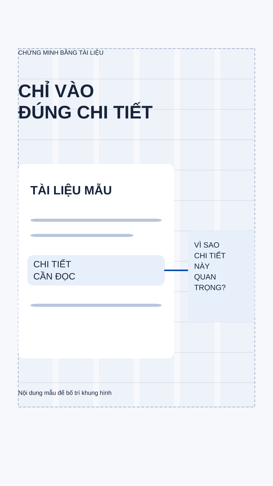
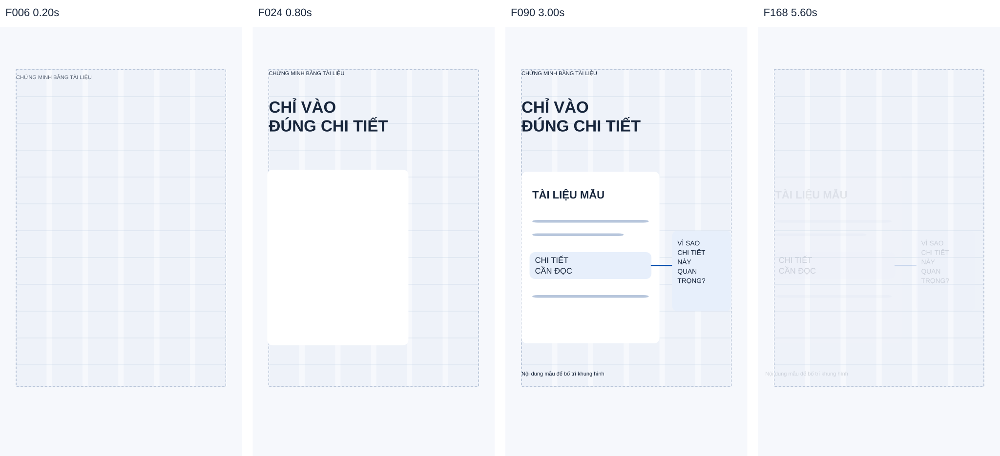

# L16 Document And Callout

Dẫn mắt từ tài liệu tới chú giải liên quan.

- Profile P 1080 × 1920, 30 fps, 180 frame.
- Phong cách gợi ý: A04 / A09. Bố cục tham chiếu: B08.
- Tọa độ ở trạng thái đọc F090. Z tăng dần từ sau ra trước.

## Layer và vùng bố trí

| Z | Layer | Loại | x | y | w | h | Thông số | Màu token | Nội dung |
| --- | --- | --- | --- | --- | --- | --- | --- | --- | --- |
| 0 | TXT_EYEBROW | text | 72 | 192 | 936 | 48 | eyebrow: 24/36px, left | ink | CHỨNG MINH BẰNG TÀI LIỆU |
| 1 | TXT_HEAD | text | 72 | 312 | 936 | 264 | title: 72/84px, left | ink | CHỈ VÀO / ĐÚNG CHI TIẾT |
| 2 | SH_DOC | shape | 72 | 648 | 616 | 768 | rect; radius 24px | white | — |
| 3 | TXT_DOC_TITLE | text | 120 | 720 | 520 | 72 | card_title: 48/60px, left | ink | TÀI LIỆU MẪU |
| 4 | SH_DOC_LINE_1 | shape | 120 | 864 | 520 | 12 | rect; radius 24px | line | — |
| 5 | SH_DOC_LINE_2 | shape | 120 | 924 | 408 | 12 | rect; radius 24px | line | — |
| 6 | SH_DOC_HIGHLIGHT | shape | 108 | 1008 | 544 | 120 | rect; radius 24px | tint | — |
| 7 | TXT_DOC_HIGHLIGHT | text | 132 | 1020 | 496 | 96 | body: 36/48px, left | ink | CHI TIẾT / CẦN ĐỌC |
| 8 | SH_DOC_LINE_3 | shape | 120 | 1200 | 520 | 12 | rect; radius 24px | line | — |
| 9 | SH_CALLOUT_LINE | line | 652 | 1068 | 92 | 0 | Stroke 6px; [(652, 1068), (744, 1068)] | brand | — |
| 10 | SH_CALLOUT | shape | 744 | 912 | 264 | 360 | rect; radius 24px | tint | — |
| 11 | TXT_CALLOUT | text | 768 | 948 | 216 | 264 | small: 30/42px, left | ink | VÌ SAO / CHI TIẾT / NÀY / QUAN / TRỌNG? |
| 12 | TXT_FOOT | text | 72 | 1536 | 936 | 60 | micro: 24/36px, left | ink | Nội dung mẫu để bố trí khung hình |

## Keyframe từng layer

| Layer | Preset | Bắt đầu | Đến đích | Ổn định | Ra hoặc giữ cuối |
| --- | --- | --- | --- | --- | --- |
| TXT_EYEBROW | M01 | F000: ΔP(0,+60), O0 | F018: ΔP(0,0), O100 | F024: ổn định | F150→F168: ΔP(0,0)→(-48,0), O100→0 |
| TXT_HEAD | M01 | F006: ΔP(0,+60), O0 | F024: ΔP(0,0), O100 | F030: ổn định | F152→F170: ΔP(0,0)→(-48,0), O100→0 |
| SH_DOC | M02 | F018: S92%, O0 | F028: S103%, O100 | F036: S100%, O100 | F156→F174: ΔP(0,0)→(-48,0), O100→0 |
| TXT_DOC_TITLE | M01 | F024: ΔP(0,+60), O0 | F042: ΔP(0,0), O100 | F048: ổn định | F158→F176: ΔP(0,0)→(-48,0), O100→0 |
| SH_DOC_LINE_1 | M02 | F024: S92%, O0 | F034: S103%, O100 | F042: S100%, O100 | F158→F176: ΔP(0,0)→(-48,0), O100→0 |
| SH_DOC_LINE_2 | M02 | F024: S92%, O0 | F034: S103%, O100 | F042: S100%, O100 | F158→F176: ΔP(0,0)→(-48,0), O100→0 |
| SH_DOC_HIGHLIGHT | M02 | F030: S92%, O0 | F040: S103%, O100 | F048: S100%, O100 | F160→F178: ΔP(0,0)→(-48,0), O100→0 |
| TXT_DOC_HIGHLIGHT | M01 | F036: ΔP(0,+60), O0 | F054: ΔP(0,0), O100 | F060: ổn định | F160→F178: ΔP(0,0)→(-48,0), O100→0 |
| SH_DOC_LINE_3 | M02 | F024: S92%, O0 | F034: S103%, O100 | F042: S100%, O100 | F158→F176: ΔP(0,0)→(-48,0), O100→0 |
| SH_CALLOUT_LINE | M03 | F036: End0%, O100 | F060: End100%, O100 | F060: giữ nét | F160→F178: ΔP(0,0)→(-48,0), O100→0 |
| SH_CALLOUT | M02 | F036: S92%, O0 | F046: S103%, O100 | F054: S100%, O100 | F160→F178: ΔP(0,0)→(-48,0), O100→0 |
| TXT_CALLOUT | M01 | F042: ΔP(0,+60), O0 | F060: ΔP(0,0), O100 | F066: ổn định | F160→F178: ΔP(0,0)→(-48,0), O100→0 |
| TXT_FOOT | M01 | F030: ΔP(0,+60), O0 | F048: ΔP(0,0), O100 | F054: ổn định | F160→F178: ΔP(0,0)→(-48,0), O100→0 |

## Bốn trạng thái motion

F006 vào, F024 dựng thông tin, F090 đọc, F168 ra hoặc giữ. Các hình minh họa được tính từ preset, không phải AE render.

## Ghi chú nội dung

Sơ đồ tài liệu không có giá trị làm bằng chứng. Khi thay ảnh tài liệu thật phải giữ ngữ cảnh và tính dễ đọc của phần trích.

## Nối cảnh

E02: cắt khớp dòng highlight với headline cảnh sau.

## Khi thay nội dung

Đo lại độ rộng từng dòng với font thật. Giữ hierarchy, khoảng trống và vùng đọc. Nếu nội dung vượt ô, ưu tiên viết gọn, đổi line break hoặc tăng thời gian và tách cảnh. Không thu toàn bộ chữ đến mức khó đọc.
