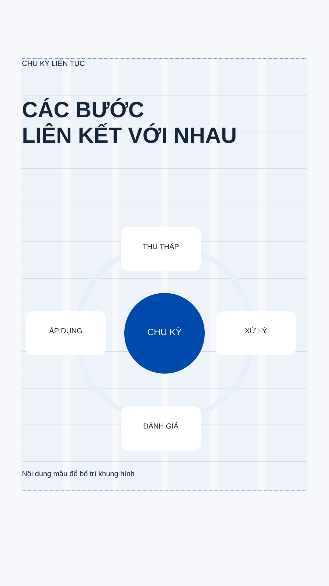
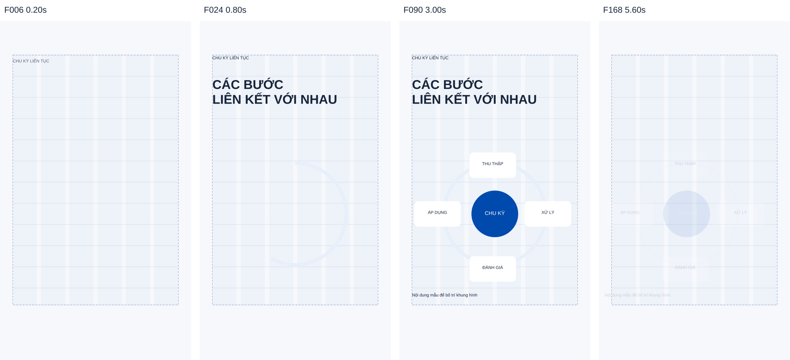

# L17 Circular Cycle

Diễn đạt vòng đời hoặc quy trình quay lại điểm đầu.

- Profile P 1080 × 1920, 30 fps, 180 frame.
- Phong cách gợi ý: A06 / A07. Bố cục tham chiếu: B09.
- Tọa độ ở trạng thái đọc F090. Z tăng dần từ sau ra trước.

## Layer và vùng bố trí

| Z | Layer | Loại | x | y | w | h | Thông số | Màu token | Nội dung |
| --- | --- | --- | --- | --- | --- | --- | --- | --- | --- |
| 0 | TXT_EYEBROW | text | 72 | 192 | 936 | 48 | eyebrow: 24/36px, left | ink | CHU KỲ LIÊN TỤC |
| 1 | TXT_HEAD | text | 72 | 312 | 936 | 264 | title: 72/84px, left | ink | CÁC BƯỚC / LIÊN KẾT VỚI NHAU |
| 2 | SH_RING | shape | 240 | 792 | 600 | 600 | ring; radius 24px | tint | — |
| 3 | SH_CENTER | shape | 408 | 960 | 264 | 264 | circle; radius 24px | brand | — |
| 4 | TXT_CENTER | text | 420 | 1068 | 240 | 60 | small: 30/42px, center | white | CHU KỲ |
| 5 | SH_CYCLE_1 | shape | 396 | 744 | 264 | 144 | rect; radius 24px | white | — |
| 6 | TXT_CYCLE_1 | text | 408 | 792 | 240 | 48 | micro: 24/36px, center | ink | THU THẬP |
| 7 | SH_CYCLE_2 | shape | 708 | 1020 | 264 | 144 | rect; radius 24px | white | — |
| 8 | TXT_CYCLE_2 | text | 720 | 1068 | 240 | 48 | micro: 24/36px, center | ink | XỬ LÝ |
| 9 | SH_CYCLE_3 | shape | 396 | 1332 | 264 | 144 | rect; radius 24px | white | — |
| 10 | TXT_CYCLE_3 | text | 408 | 1380 | 240 | 48 | micro: 24/36px, center | ink | ĐÁNH GIÁ |
| 11 | SH_CYCLE_4 | shape | 84 | 1020 | 264 | 144 | rect; radius 24px | white | — |
| 12 | TXT_CYCLE_4 | text | 96 | 1068 | 240 | 48 | micro: 24/36px, center | ink | ÁP DỤNG |
| 13 | TXT_FOOT | text | 72 | 1536 | 936 | 60 | micro: 24/36px, left | ink | Nội dung mẫu để bố trí khung hình |

## Keyframe từng layer

| Layer | Preset | Bắt đầu | Đến đích | Ổn định | Ra hoặc giữ cuối |
| --- | --- | --- | --- | --- | --- |
| TXT_EYEBROW | M01 | F000: ΔP(0,+60), O0 | F018: ΔP(0,0), O100 | F024: ổn định | F150→F168: ΔP(0,0)→(-48,0), O100→0 |
| TXT_HEAD | M01 | F006: ΔP(0,+60), O0 | F024: ΔP(0,0), O100 | F030: ổn định | F152→F170: ΔP(0,0)→(-48,0), O100→0 |
| SH_RING | M03 | F018: End0%, O100 | F042: End100%, O100 | F042: giữ nét | F156→F174: ΔP(0,0)→(-48,0), O100→0 |
| SH_CENTER | M02 | F024: S92%, O0 | F034: S103%, O100 | F042: S100%, O100 | F158→F176: ΔP(0,0)→(-48,0), O100→0 |
| TXT_CENTER | M01 | F036: ΔP(0,+60), O0 | F054: ΔP(0,0), O100 | F060: ổn định | F160→F178: ΔP(0,0)→(-48,0), O100→0 |
| SH_CYCLE_1 | M02 | F024: S92%, O0 | F034: S103%, O100 | F042: S100%, O100 | F158→F176: ΔP(0,0)→(-48,0), O100→0 |
| TXT_CYCLE_1 | M01 | F030: ΔP(0,+60), O0 | F048: ΔP(0,0), O100 | F054: ổn định | F160→F178: ΔP(0,0)→(-48,0), O100→0 |
| SH_CYCLE_2 | M02 | F030: S92%, O0 | F040: S103%, O100 | F048: S100%, O100 | F160→F178: ΔP(0,0)→(-48,0), O100→0 |
| TXT_CYCLE_2 | M01 | F036: ΔP(0,+60), O0 | F054: ΔP(0,0), O100 | F060: ổn định | F160→F178: ΔP(0,0)→(-48,0), O100→0 |
| SH_CYCLE_3 | M02 | F036: S92%, O0 | F046: S103%, O100 | F054: S100%, O100 | F160→F178: ΔP(0,0)→(-48,0), O100→0 |
| TXT_CYCLE_3 | M01 | F042: ΔP(0,+60), O0 | F060: ΔP(0,0), O100 | F066: ổn định | F160→F178: ΔP(0,0)→(-48,0), O100→0 |
| SH_CYCLE_4 | M02 | F042: S92%, O0 | F052: S103%, O100 | F060: S100%, O100 | F160→F178: ΔP(0,0)→(-48,0), O100→0 |
| TXT_CYCLE_4 | M01 | F048: ΔP(0,+60), O0 | F066: ΔP(0,0), O100 | F072: ổn định | F160→F178: ΔP(0,0)→(-48,0), O100→0 |
| TXT_FOOT | M01 | F030: ΔP(0,+60), O0 | F048: ΔP(0,0), O100 | F054: ổn định | F160→F178: ΔP(0,0)→(-48,0), O100→0 |

## Bốn trạng thái motion

F006 vào, F024 dựng thông tin, F090 đọc, F168 ra hoặc giữ. Các hình minh họa được tính từ preset, không phải AE render.

## Ghi chú nội dung

Vòng tròn chỉ nên dùng khi nội dung có tính lặp hoặc chu kỳ thật. Thêm hướng đi nếu thứ tự cần được hiểu chính xác.

## Nối cảnh

D09: dẫn theo vòng về điểm bắt đầu hoặc chuyển E01.

## Khi thay nội dung

Đo lại độ rộng từng dòng với font thật. Giữ hierarchy, khoảng trống và vùng đọc. Nếu nội dung vượt ô, ưu tiên viết gọn, đổi line break hoặc tăng thời gian và tách cảnh. Không thu toàn bộ chữ đến mức khó đọc.
