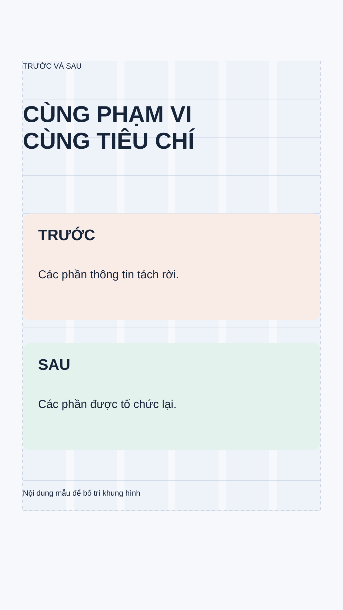
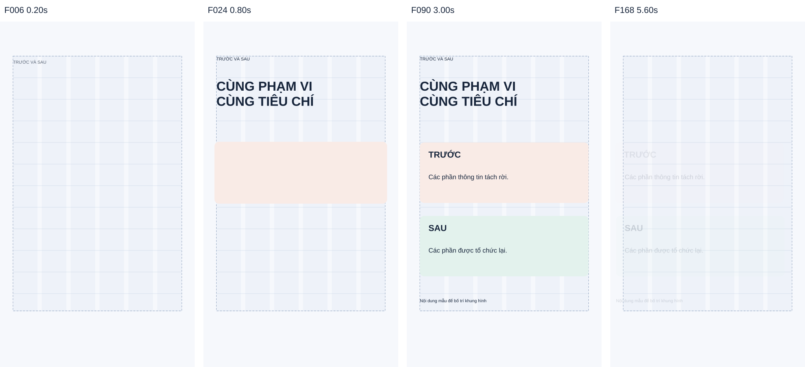

# L18 Before And After Stack

Minh họa sự thay đổi giữa hai trạng thái được so sánh công bằng.

- Profile P 1080 × 1920, 30 fps, 180 frame.
- Phong cách gợi ý: A01 / A05. Bố cục tham chiếu: B02.
- Tọa độ ở trạng thái đọc F090. Z tăng dần từ sau ra trước.

## Layer và vùng bố trí

| Z | Layer | Loại | x | y | w | h | Thông số | Màu token | Nội dung |
| --- | --- | --- | --- | --- | --- | --- | --- | --- | --- |
| 0 | TXT_EYEBROW | text | 72 | 192 | 936 | 48 | eyebrow: 24/36px, left | ink | TRƯỚC VÀ SAU |
| 1 | TXT_HEAD | text | 72 | 312 | 936 | 264 | title: 72/84px, left | ink | CÙNG PHẠM VI / CÙNG TIÊU CHÍ |
| 2 | SH_STATE_1 | shape | 72 | 672 | 936 | 336 | rect; radius 24px | warm_tint | — |
| 3 | TXT_STATE_HEAD_1 | text | 120 | 708 | 840 | 72 | card_title: 48/60px, left | ink | TRƯỚC |
| 4 | TXT_STATE_BODY_1 | text | 120 | 840 | 840 | 96 | body: 36/48px, left | ink | Các phần thông tin tách rời. |
| 5 | SH_STATE_2 | shape | 72 | 1080 | 936 | 336 | rect; radius 24px | green_tint | — |
| 6 | TXT_STATE_HEAD_2 | text | 120 | 1116 | 840 | 72 | card_title: 48/60px, left | ink | SAU |
| 7 | TXT_STATE_BODY_2 | text | 120 | 1248 | 840 | 96 | body: 36/48px, left | ink | Các phần được tổ chức lại. |
| 8 | TXT_FOOT | text | 72 | 1536 | 936 | 60 | micro: 24/36px, left | ink | Nội dung mẫu để bố trí khung hình |

## Keyframe từng layer

| Layer | Preset | Bắt đầu | Đến đích | Ổn định | Ra hoặc giữ cuối |
| --- | --- | --- | --- | --- | --- |
| TXT_EYEBROW | M01 | F000: ΔP(0,+60), O0 | F018: ΔP(0,0), O100 | F024: ổn định | F150→F168: ΔP(0,0)→(-48,0), O100→0 |
| TXT_HEAD | M01 | F006: ΔP(0,+60), O0 | F024: ΔP(0,0), O100 | F030: ổn định | F152→F170: ΔP(0,0)→(-48,0), O100→0 |
| SH_STATE_1 | M02 | F018: S92%, O0 | F028: S103%, O100 | F036: S100%, O100 | F156→F174: ΔP(0,0)→(-48,0), O100→0 |
| TXT_STATE_HEAD_1 | M01 | F024: ΔP(0,+60), O0 | F042: ΔP(0,0), O100 | F048: ổn định | F158→F176: ΔP(0,0)→(-48,0), O100→0 |
| TXT_STATE_BODY_1 | M01 | F030: ΔP(0,+60), O0 | F048: ΔP(0,0), O100 | F054: ổn định | F160→F178: ΔP(0,0)→(-48,0), O100→0 |
| SH_STATE_2 | M02 | F030: S92%, O0 | F040: S103%, O100 | F048: S100%, O100 | F160→F178: ΔP(0,0)→(-48,0), O100→0 |
| TXT_STATE_HEAD_2 | M01 | F036: ΔP(0,+60), O0 | F054: ΔP(0,0), O100 | F060: ổn định | F160→F178: ΔP(0,0)→(-48,0), O100→0 |
| TXT_STATE_BODY_2 | M01 | F042: ΔP(0,+60), O0 | F060: ΔP(0,0), O100 | F066: ổn định | F160→F178: ΔP(0,0)→(-48,0), O100→0 |
| TXT_FOOT | M01 | F030: ΔP(0,+60), O0 | F048: ΔP(0,0), O100 | F054: ổn định | F160→F178: ΔP(0,0)→(-48,0), O100→0 |

## Bốn trạng thái motion

F006 vào, F024 dựng thông tin, F090 đọc, F168 ra hoặc giữ. Các hình minh họa được tính từ preset, không phải AE render.

## Ghi chú nội dung

Cùng loại thông tin và cùng góc nhìn ở hai trạng thái. Không thay chất lượng dữ liệu hoặc cách đo để làm kết quả trông tốt hơn.

## Nối cảnh

E03: thành phần của trạng thái trước được sắp lại thành trạng thái sau.

## Khi thay nội dung

Đo lại độ rộng từng dòng với font thật. Giữ hierarchy, khoảng trống và vùng đọc. Nếu nội dung vượt ô, ưu tiên viết gọn, đổi line break hoặc tăng thời gian và tách cảnh. Không thu toàn bộ chữ đến mức khó đọc.
