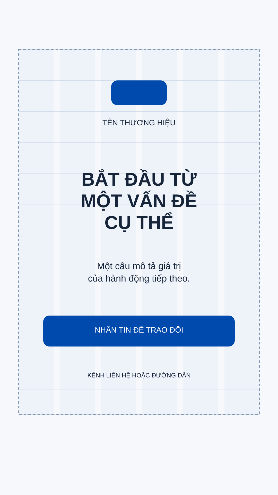
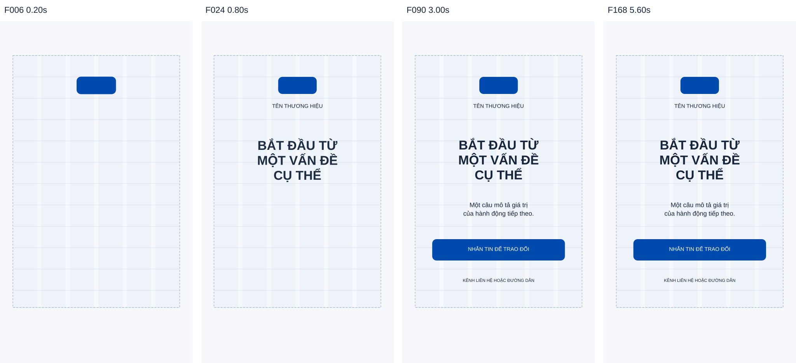

# L19 CTA End Card

Kết thúc bằng một hành động cụ thể và một cách thực hiện.

- Profile P 1080 × 1920, 30 fps, 180 frame.
- Phong cách gợi ý: A01 / A02. Bố cục tham chiếu: B01.
- Tọa độ ở trạng thái đọc F090. Z tăng dần từ sau ra trước.

## Layer và vùng bố trí

| Z | Layer | Loại | x | y | w | h | Thông số | Màu token | Nội dung |
| --- | --- | --- | --- | --- | --- | --- | --- | --- | --- |
| 0 | SH_BRAND | shape | 432 | 312 | 216 | 96 | rect; radius 24px | brand | — |
| 1 | TXT_BRAND | text | 120 | 456 | 840 | 60 | small: 30/42px, center | ink | TÊN THƯƠNG HIỆU |
| 2 | TXT_HEAD | text | 72 | 648 | 936 | 264 | title: 72/84px, center | ink | BẮT ĐẦU TỪ / MỘT VẤN ĐỀ / CỤ THỂ |
| 3 | TXT_SUPPORT | text | 168 | 1008 | 744 | 96 | body: 36/48px, center | ink | Một câu mô tả giá trị / của hành động tiếp theo. |
| 4 | SH_CTA | shape | 168 | 1224 | 744 | 120 | rect; radius 24px | brand | — |
| 5 | TXT_CTA | text | 192 | 1260 | 696 | 60 | small: 30/42px, center | white | NHẮN TIN ĐỂ TRAO ĐỔI |
| 6 | TXT_CONTACT | text | 120 | 1440 | 840 | 60 | micro: 24/36px, center | ink | KÊNH LIÊN HỆ HOẶC ĐƯỜNG DẪN |

## Keyframe từng layer

| Layer | Preset | Bắt đầu | Đến đích | Ổn định | Ra hoặc giữ cuối |
| --- | --- | --- | --- | --- | --- |
| SH_BRAND | M02 | F000: S92%, O0 | F010: S103%, O100 | F018: S100%, O100 | Giữ đến F179; kết thúc/loop theo ghi chú |
| TXT_BRAND | M01 | F006: ΔP(0,+60), O0 | F024: ΔP(0,0), O100 | F030: ổn định | Giữ đến F179; kết thúc/loop theo ghi chú |
| TXT_HEAD | M01 | F012: ΔP(0,+60), O0 | F030: ΔP(0,0), O100 | F036: ổn định | Giữ đến F179; kết thúc/loop theo ghi chú |
| TXT_SUPPORT | M01 | F024: ΔP(0,+60), O0 | F042: ΔP(0,0), O100 | F048: ổn định | Giữ đến F179; kết thúc/loop theo ghi chú |
| SH_CTA | M02 | F030: S92%, O0 | F040: S103%, O100 | F048: S100%, O100 | Giữ đến F179; kết thúc/loop theo ghi chú |
| TXT_CTA | M01 | F036: ΔP(0,+60), O0 | F054: ΔP(0,0), O100 | F060: ổn định | Giữ đến F179; kết thúc/loop theo ghi chú |
| TXT_CONTACT | M01 | F042: ΔP(0,+60), O0 | F060: ΔP(0,0), O100 | F066: ổn định | Giữ đến F179; kết thúc/loop theo ghi chú |

## Bốn trạng thái motion

F006 vào, F024 dựng thông tin, F090 đọc, F168 ra hoặc giữ. Các hình minh họa được tính từ preset, không phải AE render.

## Ghi chú nội dung

Không tạo QR giả. Nếu dùng QR cần mã thật, đủ tương phản, đủ thời gian và kiểm tra quét. Mẫu chỉ thể hiện vùng thương hiệu.

## Nối cảnh

Giữ CTA đến F179 nếu video kết thúc; chỉ dùng exit khi thật sự có cảnh tiếp theo.

## Khi thay nội dung

Đo lại độ rộng từng dòng với font thật. Giữ hierarchy, khoảng trống và vùng đọc. Nếu nội dung vượt ô, ưu tiên viết gọn, đổi line break hoặc tăng thời gian và tách cảnh. Không thu toàn bộ chữ đến mức khó đọc.
