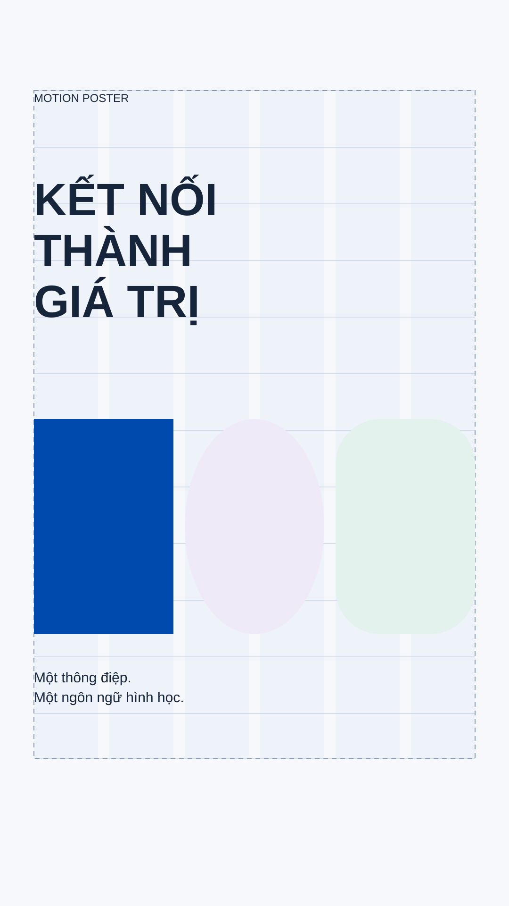
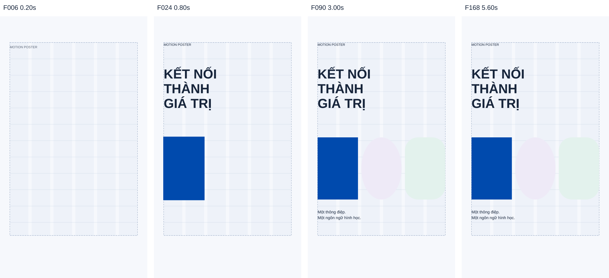

# L20 Motion Poster

Một headline kết hợp hệ shape có thể lặp theo chu kỳ.

- Profile P 1080 × 1920, 30 fps, 180 frame.
- Phong cách gợi ý: A02 / A06. Bố cục tham chiếu: B04.
- Tọa độ ở trạng thái đọc F090. Z tăng dần từ sau ra trước.

## Layer và vùng bố trí

| Z | Layer | Loại | x | y | w | h | Thông số | Màu token | Nội dung |
| --- | --- | --- | --- | --- | --- | --- | --- | --- | --- |
| 0 | TXT_EYEBROW | text | 72 | 192 | 936 | 48 | eyebrow: 24/36px, left | ink | MOTION POSTER |
| 1 | TXT_HEAD | text | 72 | 360 | 936 | 360 | display: 96/108px, left | ink | KẾT NỐI / THÀNH / GIÁ TRỊ |
| 2 | SH_PATTERN_A | shape | 72 | 888 | 296 | 456 | rect; radius 0px | brand | — |
| 3 | SH_PATTERN_B | shape | 392 | 888 | 296 | 456 | circle; radius 24px | purple_tint | — |
| 4 | SH_PATTERN_C | shape | 712 | 888 | 296 | 456 | rect; radius 96px | green_tint | — |
| 5 | TXT_CAPTION | text | 72 | 1416 | 936 | 96 | small: 30/42px, left | ink | Một thông điệp. / Một ngôn ngữ hình học. |

## Keyframe từng layer

| Layer | Preset | Bắt đầu | Đến đích | Ổn định | Ra hoặc giữ cuối |
| --- | --- | --- | --- | --- | --- |
| TXT_EYEBROW | M01 | F000: ΔP(0,+60), O0 | F018: ΔP(0,0), O100 | F024: ổn định | Giữ đến F179; kết thúc/loop theo ghi chú |
| TXT_HEAD | M01 | F006: ΔP(0,+60), O0 | F024: ΔP(0,0), O100 | F030: ổn định | Giữ đến F179; kết thúc/loop theo ghi chú |
| SH_PATTERN_A | M02 | F018: S92%, O0 | F028: S103%, O100 | F036: S100%, O100 | Giữ đến F179; kết thúc/loop theo ghi chú |
| SH_PATTERN_B | M02 | F024: S92%, O0 | F034: S103%, O100 | F042: S100%, O100 | Giữ đến F179; kết thúc/loop theo ghi chú |
| SH_PATTERN_C | M02 | F030: S92%, O0 | F040: S103%, O100 | F048: S100%, O100 | Giữ đến F179; kết thúc/loop theo ghi chú |
| TXT_CAPTION | M01 | F036: ΔP(0,+60), O0 | F054: ΔP(0,0), O100 | F060: ổn định | Giữ đến F179; kết thúc/loop theo ghi chú |

## Bốn trạng thái motion

F006 vào, F024 dựng thông tin, F090 đọc, F168 ra hoặc giữ. Các hình minh họa được tính từ preset, không phải AE render.

## Ghi chú nội dung

Không dùng exit fade nếu cần loop liền. Chuyển động loop phải khớp cả trạng thái và hướng vận tốc tại đường nối.

## Nối cảnh

Biến thể loop riêng: chữ giữ, shape chạy chu kỳ 120 frame; xem M10 trong tài liệu motion.

## Khi thay nội dung

Đo lại độ rộng từng dòng với font thật. Giữ hierarchy, khoảng trống và vùng đọc. Nếu nội dung vượt ô, ưu tiên viết gọn, đổi line break hoặc tăng thời gian và tách cảnh. Không thu toàn bộ chữ đến mức khó đọc.
